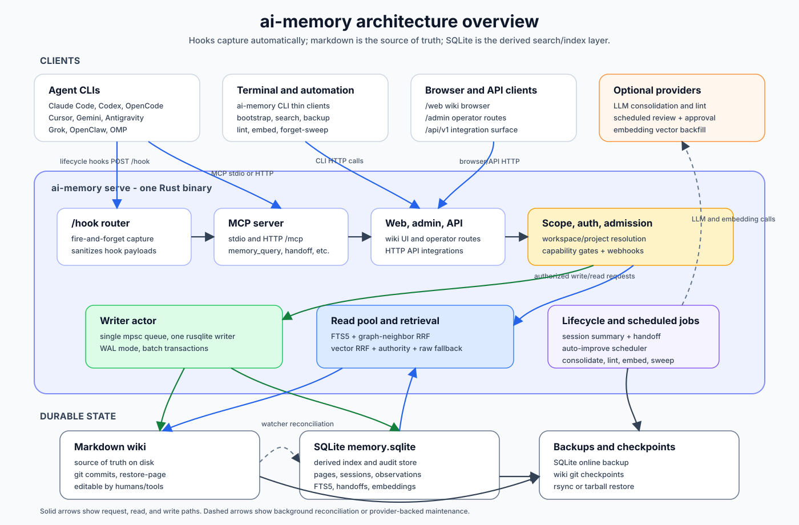

# ai-memory - Architecture

> One canonical doc for "what is this thing and how is it shaped".
> Long-form research lives next to this file under [`docs/`](.); this
> page is the operational summary for someone reading the code.

## Purpose

ai-memory is a single Rust binary that gives the coding agents in the
[README Support Matrix](../README.md#support-matrix), plus other MCP-capable
clients, long-term memory shared across CLIs.
You can quit one mid-task, open another in the same directory, and
continue, without manual `write_note` calls or copy-pasting summaries
between sessions.

What accumulates is a **Karpathy-style LLM wiki**: a git-versioned tree
of markdown pages on disk that gets *compiled* and appended to over time.
Pages are versioned in place via supersession, semantic concepts build on
each other, and episodic logs decay. A
companion SQLite index gives FTS5 + lexical entity + link-neighbor retrieval,
with optional vectors; the markdown stays the source of truth.

The optional `management-ui` feature enables an askama/Tailwind console at
`/manage`, enabled separately at runtime. Its login page is public; its
`/management/v1` data and mutation routes reuse human-session authentication and
CSRF. Admin actions use existing root-only handlers. Self-service session purges
recheck exact ownership and current project write access inside the writer
transaction, then remove files through `Wiki`. Shared pages keep their existing
read behavior. See [management-ui.md](management-ui.md).

## Data flow



Solid arrows are request, read, and write paths. Dashed arrows are
background reconciliation or provider-backed maintenance. The core invariant is
unchanged: the markdown wiki is the source of truth, and SQLite is the derived
index for search, sessions, observations, handoffs, audit, embeddings, and the
optional managed-workstream continuity ledger.
Auto-improvement sits on the provider-backed maintenance side: the server
schedules reviews for newly completed sessions in every project, records
validated proposals in the pending-writes audit trail, and auto-approves them
through the normal wiki write path by default. Scheduler ticks are
non-overlapping; long all-project review passes delay the next tick instead of
starting another copy. Scheduling and approval are separate. Admins can set
`[auto_improve.scheduler] enabled = false` to stop background review, or
`[auto_improve] require_approval = true` to leave scheduled and manual proposals
pending for review. Operators can additionally set `[auto_improve.eval]` to run
a project-supplied executable gate for selected proposal prefixes after LLM
validation and before staging/approval; it is disabled by default and never runs
from hook paths.

**Steady-state loop:**

1. Agent CLI emits a lifecycle hook (SessionStart, UserPromptSubmit,
   PostToolUse, …). Shell-script hooks `curl` event JSON to `POST /hook`
   with a short timeout. Native `ai-memory hook --event ...` commands spool
   events locally with a stable per-entry idempotency key, do a short bounded
   cleanup at session start, and hand
   session-end delivery to a detached lock-aware `hook-drain` helper (Zero,
   whose hook sandbox kills detached children, drains in-process within a
   fixed 10-second budget instead);
   high-latency operators can raise the drain/handoff/background caps with
   minute-based env vars.
   Agent hot paths never block on the network; saturated servers return HTTP
   429 instead of queueing unbounded work. A native spool drain pauses that
   endpoint for the rest of its pass without charging retry attempts; queued
   events for other endpoints still deliver with their own credentials.
   For supported native commands and generated OpenCode/OMP/Pi/OpenClaw
    integrations, the nearest-marker capture policy runs first: a dropped
    recognized file-tool event never enters spool, queue, transport, logs, or
    storage. The separate nearest settings marker may also forward a bounded
    JSON-array `aliases` query value on both capture and SessionStart handoff
    lookup. The router accepts it only with marker provenance and the checkout's
    normalized hostful git-remote identity, and resolves names inside the
    selected workspace; the cache key includes aliases, provenance, and
    read/write mode. See
    [the marker reference](marker-file.md).

2. Server's hook router sanitises the payload (the only path from
   untrusted text into the store), assigns an [`ObservationKind`], and
   enqueues a `WriteCmd` to the writer actor. For native keyed events, the
   project-scoped key and observation commit together. Ordinary keys expire
   after 30 days; validated `recovery_<55 hex>` keys are bound to the actual
   session, agent, event kind, and sanitized event identity and retained until
   session/project deletion, so a writer cannot preclaim another recovery
   event and an old journal cannot duplicate observations after ordinary
   cleanup. The key is marked
   complete only after downstream processing: an incomplete replay resumes
   wiki/handoff effects without another observation, while a completed replay
   is acknowledged and skipped. A bounded per-project/key gate serializes an
   overlapping retry with the original processor. Downstream effects remain
   at-least-once until that completion marker, so a process crash during those
   effects may repeat an already applied effect rather than silently lose the
   rest. For an interrupted already-ended SessionEnd, the replay converges the
   wiki commit, durable provider job, and pending key without appending another
   observation. `log.md` gets an appended
   `## [YYYY-MM-DDTHH:MM:SSZ] <event> | <title>` line.
   Inline `/hook/batch` ACKs include an outcome per acknowledged index.
   Process-lifetime counters distinguish stored events, replays, recovery and
   ignored endings. `last_persisted_ms` advances after a durable write or terminal
   effect; retries and no-op endings do not advance it. Normal checkpoints reuse
   the observation write timestamp; only recovery checks for a new page version.
3. On true `SessionEnd` events, the server synthesises a
   `sessions/<id>.md` summary page (rule-based, no LLM) and opens a
   `Handoff` row for the next agent. One SQLite transaction inserts that
   automatic handoff, stamps the session ended, and records the covered
   observation count, so recovery never sees only half of those DB effects. A
   later SessionEnd re-runs the path only when that generation advances, so
   resumed sessions are captured while duplicate delivery and clock skew
   converge. Existing ended sessions are baselined at migration instead of
   becoming historical catch-up work. Auto-commits the wiki. Clients
   without a reliable true session-end hook need an explicit ending action:
   `ai-memory finalize-session --agent antigravity-cli` for Antigravity CLI
   (Codex has a native `SessionEnd` since CLI 0.145.0; `finalize-session
   --agent codex` is only the fallback on older Codex). OpenCode 2 and
   Antigravity also publish a turn checkpoint on a finished `Stop`: the
   session page and the session's one open handoff are refreshed in place
   while the session stays open.
   The command selects the latest matching open session and enters the same
   canonical SessionEnd path as a native hook. Generated session-page
   frontmatter records `session_id` plus the immutable `sessions.agent_kind`
   as `agent`; it describes the page's harness origin, not the later writer.
   Manual page writes do not receive inferred agent metadata. A session that
   never delivered a `SessionEnd` (crashed harness, closed terminal) is ended
   by the maintenance tick when `[sessions] idle_end_after_hours` is set, with
   the tick's own page write, the consolidation job and the lifecycle-only
   handoff release — no additional handoff from the tick. The page write is
   conditional on the page version the selection captured in its own
   statement, and the end stamp is a CAS on `ended_at IS NULL` that also
   re-verifies the session's observation count (the digest's population) and
   the latest page version — so a late real `SessionEnd` (or a checkpoint)
   wins that race and converges through `AlreadyEnded`/`ReEnd`. `ended_at` is
   the tick's clock (the session's last activity is preserved in the audit
   detail), and the consolidation job is enqueued inside the stamp's
   transaction.
   If a harness is cut off before `SessionEnd`, the next `SessionStart` also
   looks for the most recently active substantive open session in the same
   project and ownership boundary. It renders a read-only recovery snapshot
   from the newest 64 stored observations, capped at 6,000 characters. A
   handoff that covers the newest work suppresses the snapshot, and when a
   handoff is delivered, other uncovered work stays a metadata-only pointer.
   The source stays open (parallel agents are valid), no extra handoff row is
   created, and nothing from other project scopes is loaded. When assistant
   `Stop` excerpts are enabled (they pass a privacy gate), the excerpt is the
   preferred latest checkpoint. Otherwise recent prompts and lifecycle or
   tool metadata provide context for resuming work.
4. When `AI_MEMORY_LLM_PROVIDER` is set, `memory_consolidate` rewrites
   that summary into a richer durable page or fans out into a
   multi-page batch under `concepts/`, `decisions/`, `gotchas/`. Consolidation
   prompts preserve the source material's dominant natural language and ask
   the model to connect related pages with path-based wikilinks. The default
   single-page and batch prompts lead the user content with their stable
   blocks (the fixed batch text, meaning header + field schema, and the
   project instructions), followed by the current body / slot and title state, and
   only then the session id and observation dump, so providers with prefix
   caching can reuse the stable prefix. In the single-page prompt the current
   body is the session's own page body (`sessions/<id>.md`), so it varies per
   session: the prefix shared across sessions of one project is the system
   prompt plus the instructions block when present, and the titles block
   follows the variable body. The input budget remains an approximate
   character estimate; cache eligibility is not a measured hit.
5. When an LLM provider is configured, the auto-improvement scheduler reviews
   newly completed sessions across all projects outside hook latency. It records validated
   `concepts/`, `decisions/`, `gotchas/`, `procedures/`, and `_rules/` proposals
   in the pending-writes audit trail, then approves them through the wiki
   mutation path by default. The scheduler initializes a per-project first-run
   watermark so historical sessions are not processed automatically on upgrade,
   then records per-session claims before LLM work so failed scheduled reviews do
   not retry forever. Explicit CLI/admin/MCP auto-improve calls use the same
   pipeline for targeted reruns or catch-up. With `[auto_improve]
   require_approval = true`, scheduled and manual proposals remain pending until
   explicit pending-writes approval. If `[auto_improve.eval] enabled = true`,
   targeted proposals (default `_rules/` and `procedures/`) must pass the
   configured executable JSON contract before they are staged; failures become
   rejected candidates/rejection-buffer entries rather than wiki writes. Like
   the consolidation prompts, the per-session reviewer, the cross-session
   experience pass, the dream merge and the lint contradiction pass write
   prose in the dominant natural language of their input.
   Every LLM prompt treats repository text, observations, wiki pages, and prior
   proposals as untrusted data rather than instructions. The same explicit
   trust boundary and delimiters precede automatically injected handoffs,
   project briefs, and managed-workstream packets; current instructions and
   checkout state remain authoritative.
6. `memory_query` answers via FTS5 + entity-match + link-neighbour RRF; a
   transactionally maintained auxiliary unigram/bigram FTS stream handles
   unspaced Han, Kana, and Hangul queries without changing the ordinary
   unicode61 path for non-CJK text. When an
   embedder is configured, vector cosine over `page_embeddings` joins the same
   RRF. The entity index is derived from the canonical frontmatter `entities`
   list, and an empty index contributes no candidates or score. Before final
   truncation, a bounded authority multiplier adjusts relevance using canonical
   page kind, tier, `pinned`, and explicit positive/negative frontmatter tags.
   It favors maintained rules, decisions, procedures, and gotchas in close
   contests while keeping episodic, historical, lint, and test evidence
   searchable. No query-intent regex or hard exclusion participates. An
   optional `AI_MEMORY_RERANKER=llm` pass sends a bounded query plus up to 30
   bounded titles/snippets to the configured provider after project/scope
   fusion; it is limited to one call per query and four calls in flight, and any
   invalid, failed, timed-out, or saturated attempt preserves the local order.
   Global and supplemental global-preference results do not take this path.
   With `[retrieval] observation_stream` (on by default), project and `scopes`
   searches add one more RRF stream: full-text search over `observations_fts`
   in the same `(workspace, project)`, where each matching session votes once,
   through its best-ranked observation, for its own latest unexpired
   `sessions/<id>.md` page in that scope. The vote never crosses projects (both
   the observation and the page are scope-filtered), a session without a page
   contributes nothing, and nothing is written. Setting it to `false` restores
   the earlier ranking byte for byte. Every operator's observations vote, since
   session pages are shared, but a vote's excerpt and observation ids are
   attached only when the caller may read that session under the session
   timeline's owner rule (their own sessions and unattributed ones); otherwise
   the hit shows the page's own snippet. If
   compiled wiki pages miss entirely in default, explicit project, or explicit
   `scopes` mode, bounded raw observation FTS returns fallback `raw_hits`, from
   sessions the caller may read under that same rule. Hits only the vector
   streams (or graph neighbours of theirs) found count as a miss here: those
   streams have no similarity floor and answer every query once a page has an
   embedding;
   `global=true` searches compiled wiki pages across projects only. Page hits
   bump `access_count` + `last_accessed_at`, the M8 reinforcement term, which
   `memory_feedback` complements with explicit per-page salience. Identified
   operators also add one `page_access` row per page; an opt-in
   `[decay] breadth_weight` can reward pages reinforced by several distinct
   operators. That bump is throttled to at most once per page per minute, so a
   burst of overlapping searches does not flood the writer actor with
   redundant reinforcement writes. The same reinforcement fires from every
   read path that surfaces a page, not just search: `memory_read_page` (and its
   `include_related` walk, which reinforces the walked neighbours too) and
   `memory_explore` (the pages it surfaces) bump the same counters through the
   same throttled, FTS-exempt path, so a page a human opens directly or the
   graph surfaces resists decay like a query hit (design-memory-aging.md C1).
7. The forget sweep runs on demand and on the server's `[maintenance]`
   schedule: pages past their frontmatter `expires_at:` TTL are
   hard-deleted through the wiki layer (file + rows, pin or not);
   pages with `retention < cold_threshold` are evicted through the wiki layer,
   which removes the authoritative file and leaves a decay tombstone;
   tombstones older than `hard_delete_after_days` are purged with their full
   version ancestry only within that sweep's resolved workspace/project,
   together with entity-index rows orphaned by the purge. A newer page recreated
   at the same path is preserved. Semantic / pinned / freshly-touched pages
   survive. A fourth pass, disabled unless `[decay] observation_retention_days`
   is positive, then deletes raw `observations` older than that age, but only
   for sessions already consolidated into a summary page that is still live, so
   raw capture is never removed while it is the last copy of that session's
   work, and never for a session that still has a `session_consolidation_jobs`
   row in `pending` or `running` — a queued (or lease-stale) consolidation
   still reads the raw capture — and never while the live observation count is
   newer than `sessions.ended_observation_count`, which closes the interval
   between resumed capture and its next queue insertion. The dry-run count
   applies the same guard for the same snapshot. It runs last so this run's own
   evictions and hard-deletes already exclude their sessions, deletes in
   `observation_prune_batch` transactions so a multi-million row prune cannot
   hold the write lock, and repairs
   `sessions.ended_observation_count` downward in the same transaction. The
   prune is irreversible in a specific sense: observations are the input to
   consolidation, so a pruned session can never be re-consolidated (not with
   a better model, a better prompt, or a fixed consolidator bug), and its
   summary page becomes the only surviving account of that session. Freed
   SQLite pages are reused rather than returned to the OS: the `.db` file does
   not shrink, but the backup tarball does. A fifth pass, disabled unless
   `[decay] ledger_retention_months` is positive (env
   `AI_MEMORY_DECAY__LEDGER_RETENTION_MONTHS`), deletes old hook event ledgers
   (`log-YYYY-MM.md`) once that many whole UTC calendar months have passed
   after their month ended. It qualifies a file by name AND content (the
   `log_ledger` predicates), never touches `log.md`, never touches the current
   or the previous month whatever the setting, and removes files through
   `Wiki::delete_event_ledger` (confined, under the wiki mutation guard,
   content gate re-checked) rather than from the sweep. Each removal consults
   the blocking admission chain on the `delete_event_ledger` op, the same
   check a page delete runs: a `reject`-policy webhook keeps the file, which
   the sweep counts in `ledgers_undeleted`, keeps going and retries next run —
   and non-blocking observers are dispatched only after the unlink. Ledgers are
   not pages:
   the store is only read, and a legacy `pages` row for a deleted ledger is left
   for `reclaim-ledger-versions`. A dry run reports the files and bytes it would
   delete (`ledgers_prunable`, `ledger_bytes_prunable`) and deletes nothing.
   Scheduled sweep, rule-based lint, and opt-in embedding backfill ticks
   enumerate every existing workspace/project scope before doing per-project
   work, matching the auto-improvement scheduler's store-wide scope model. A
   separate daily cleanup removes week-old project rows only when they contain
   no pages, sessions, observations, handoffs, managed workstreams, sent or
   received agent messages (including claimed/cancelled history), or
   auto-improvement data; managed continuity history therefore keeps its
   project scope alive even when no lifecycle-hook session has been captured.
   The same scheduled sweep tick also runs one store-wide
   `close_abandoned_sessions` batched `UPDATE`. A session with no activity
   for 48 hours and no `SessionEnd` gets `ended_at` set from its own last
   activity, with no summary page and no usage. This keeps
   `open_session_count` from growing on sessions nobody continues, and it is
   narrower than a real end (see the session-usage row below).
   A session that is continued, meaning a new session starts in the same
   scope while the old one has been quiet for 15 minutes or more, is closed
   sooner on the client, including usage recovery. After that threshold the
   read-only recovery packet that `render_interrupted_session_context`
   (`ai-memory-hooks/src/router.rs`) builds also carries a machine-parsed
   marker. The client uses it to find the old session's transcript, report
   its usage and send a normal synthetic `SessionEnd`. This is safe even if
   the old session is still live: a later real `SessionEnd` with more
   observations than the early close saw re-runs the full end path
   (`SessionEndDisposition::ReEndWithNewWork`, issue #152).
8. Backups: `ai-memory backup --to <tarball>` uses SQLite's online
   backup API so the source stays writable; `ai-memory restore`
   reverses. Or: `git push` the wiki dir + `rsync` the data dir.

**Session-start continuity notice:** `GET /handoff` also names a session that
was cut off without ending. It reads the project's sessions ordered by their
newest prompt, tool, stop or compaction observation over the last seven days
(`ReaderPool::recent_session_activity`, owner-filtered on the session row). It
adds a notice when the newest one is not the receiver's own session, neither
ended nor wrote a handoff after that work (a per-turn checkpoint baton covers
the turn it closed), and is newer than both the receiver's own work and any
handoff being delivered. The notice carries only the agent kind, session id, age and
scope names, never captured text, and points at
`memory_read_session_observations`. A client that re-fetches on every prompt
sends `profile_digest=0` after the first, which also stops the notice.
`memory_briefing` lists the same ordering as `recent_sessions`, and
`memory_handoff_list` names the session as `newer_unended_session` when it is
newer than every open handoff. `memory_read_session_observations` without a
`session_id` reads from the same ordering: the newest other session in the
caller session's cwd, then the newest other session in the scope.

**Session-start project brief:** when the project's marker sets
`[briefing] inject_on_session_start`, `GET /handoff` appends a brief of the
project's pinned, `_rules/` and `_slots/` pages, packed into `[briefing]
max_chars` (clamped to 1500-20000) with no LLM call. Every page first gets an
extractive L0 excerpt (`ai_memory_core::excerpt`: frontmatter `abstract`, else
`summary`, else the leading prose read across paragraphs and lists, 256
bytes); the bytes left deepen
pages to an L1 excerpt (`summary` first, 500 bytes, the same clip as A2
compaction) and then to the whole body, pinned and `_slots/` pages before the
rest, other bodies cheapest first (`ai_memory_hooks::brief_tiers`). A body is included whole or not at all.
A body shorter than the frontmatter excerpt it would replace always shows
whole, priced at its own size.
Four or more unpinned excerpts of one family share a heading. Pages that do not
fit are listed by path for `memory_read_page`, and the count of them is
reserved before any page is deepened. The security notice, the
untrusted-history fence (with fence markers inside page text escaped) and the
closing footer are never traded for content. The accepted algorithm and its
budget invariants are recorded in
[`design-tiered-session-brief.md`](design-tiered-session-brief.md).

**Subagent brief:** when the marker sets `[briefing] inject_on_subagent_start`,
the `claude-code` agent's `SubagentStart` hook prints the same brief as the subagent's
`additionalContext`. It comes from `GET /brief`, which resolves and authorizes
the project exactly as `/handoff` does (one shared helper) and renders only the
brief: it never reads or claims a handoff, publishes no active project and
records no `[profile]` flags, since a subagent runs inside its parent's
session. For that agent the budget is also capped at 9,800 characters, under
the 10,000-character hook context limit. A server without the route answers
404 and the hook prints `{}` as before; it never falls back to `/handoff`.

**Cross-project profile:** after the project brief, SessionStart appends a
fenced, byte-budgeted, byte-stable digest of the user's usual choices from other
projects (`docs/cross-project-profile.md`), filtered by the stack the project's
activity shows, with a larger baseline for a project that has no pages yet. It
is on by default for a single-operator server and off for a multi-user one.
Entries are learned by the profile pass (`ai_memory_consolidate::profile`), run
by a server worker shortly after startup, a debounced moment after every
SessionEnd (`HookState::profile_notify`), hourly, and on
`POST /admin/profile/rebuild`. It **harvests** each contributing project past
its marks (`profile_harvest_marks`): preference-shaped sentences of
`user-prompt` observations (never tool output), the project's `_rules/`,
`decisions/`, `gotchas/` and `procedures/` pages, and its stack signals, into
`profile_candidates`. It then **converges** per profile scope: candidates group
by topic-token overlap across projects; a group stated as general or seen in
`min_projects` projects becomes a `profile/<category>/<slug>.md` page written
through `Wiki::write_page`, the newest statement winning (the replaced version
stays in the supersession chain). Pages it did not write, or whose body changed
since it wrote them, are never rewritten; `profile_entry_ledger` keeps a removed
entry removed until newer evidence arrives. With an LLM provider and
`[profile] llm`, classification and the per-entry merge use JSON-schema
structured calls and fall back to the zero-LLM path on any error. A private
profile converges only its operator's own candidates from projects they can
read; a shared profile on a multi-user server skips restricted projects.
`ai-memory profile apply` reads `GET /admin/profile/apply` (the digest's
selection, capped at `apply_max_lines`, empty for a `consume = false` project)
and writes it between `<!-- ai-memory:profile:start/end -->` delimiters in the
repository's rules file through `apply_atomic` (tmp + rename + fsync, backup
under `<data_dir>/backups/profile-apply/`); it is the only profile path that
writes outside the wiki, and only when the user runs it.

**Optional managed-workstream loop:** `ai-memory run` opens a lease for the
current repository/worktree workstream, resolves an explicit harness or the
newest usable local/linked harness, creates or resumes that harness's native
session, and marks lifecycle calls with an invocation-scoped run id.
SessionStart injects an unseen bounded event range; Crush receives it through a
temporary supported global-context path because it lacks SessionStart. The host
also pins the newest other-harness session identity when a launch is a real
harness switch. The client revalidates that identity against the checkout and
materializes a private temporary visible-history dossier for the child through
`AI_MEMORY_PREVIOUS_SESSION_HISTORY`; its path and body remain client-local and
the file is removed with the child. The host imports the native transcript tail
and a Git checkpoint when the child exits.
Every injected packet starts with a versioned origin marker. The Claude
transcript normalizer excludes a marked packet if Claude persists and reads it
back, preventing delivered history from recursively re-entering the ledger.
An explicitly pending handoff is considered before the managed event range.
By default their single-use delivery claims share one writer transaction after
the complete startup response has been assembled. With server-wide
`[handoff].claim_on_session_start = false`, SessionStart instead emits a
metadata-only notice naming the exact handoff id and leaves the row open for
an explicit `memory_handoff_accept`; the managed event range is still claimed.
The non-destructive offer-mode rationale is recorded in
[`design-handoff-offer-not-claim.md`](design-handoff-offer-not-claim.md).
With server-wide `[handoff].create_on_session_end = false`, session end writes
the summary page and enqueues consolidation but skips creating an automatic
baton, and an OpenCode or Antigravity turn checkpoint refreshes the page
without one (#1043). Manual handoffs take precedence;
otherwise the newest cwd-eligible automatic handoff is delivered, and that
same transaction expires older eligible automatic handoffs while preserving
manual and sibling-directory work. Insertion also expires prior open automatic
handoffs from the exact cwd, bounding repeated SessionEnds before any receiver
starts.
`GET /recap?session_id=` answers a prompt that starts with `reload context`
(Claude Code and Codex in the `UserPromptSubmit` envelope, Grok on the next
`PostToolUse`, OpenCode through its system/context hooks). It is read-only and
anchored on the session row rather than a cwd: project read authorization and
the handoff owner filter gate it, and it renders the captured prompts and last
reply between the session's latest two `pre-compact` observations plus the
project's open handoffs, listed without a claim.
ai-memory opens native stores read-only. Raw sanitized JSONL segments are
immutable, while SQLite supplies monotonic sequences, FTS, native
source/delivery cursors, and idempotent retry state. A full-ledger
`workstream-search` path complements
the bounded startup packet. An interactive empty workstream may adopt a
checkout-matching native session once. Eligibility comes from authoritative
ledger/session state: after any harness establishes the workstream, a newly
joining harness starts fresh and receives portable history instead of adopting
unrelated old native history. Handled launcher failures cancel their lease;
normal reopen retries brief finalization conflicts, while an unclean process
death remains bounded by the renewable lease expiry. An explicit
`--force-unlock` recovery expires and replaces a selected active lease in the
same writer transaction, but only when its durable operator attribution equals
the new run's attribution; the informational `host:pid` lease label is never an
authorization key. The old run can no longer heartbeat or finish normally.
`POST /workstream/runs/{run_id}/recover/finish` is the narrower outage path: it
reuses the normal owner and project-write checks and admits an expired run only
when no newer run in that workstream superseded it. A finished retry validates
only durable transcript/native/cursor/exit identity and does not regenerate a
repository checkpoint. Degraded resumed sessions persist a validated native
source cursor before launch, and bounded recovery export reads only the delta
on a blocking worker. See [Managed cross-harness
workstreams](managed-workstreams.md).

## Hook event vocabulary

The core observation vocabulary is a closed set of agent lifecycle
events. Hook bridges may accept client-specific aliases, but storage
normalises them to exactly one of these `ObservationKind` values:

| Stored kind | Semantics |
|---|---|
| `session-start` | Agent session began; cwd/model/session identity captured. |
| `user-prompt` | User submitted prompt text to the agent. |
| `pre-tool-use` | Agent is about to call a tool. |
| `post-tool-use` | Agent finished a tool call. |
| `pre-compact` | Agent is about to compact or compress its context. |
| `post-compaction` | Agent compacted context and supplied a post-facto summary or checkpoint. |
| `notification` | Agent emitted a notification-style event. |
| `stop` | Agent finished an interactive turn or stopped naturally. |
| `session-end` | Agent session ended; summary/handoff path may run. |
| `other` | Unknown or unsupported hook event. |

Native hook clients correct one otherwise invisible cross-project case before
spooling: if a recognized tool payload's absolute location (file-tool targets,
a search/list tool's `path`, or a shell command's `workdir`) lies in one other
repository/marker boundary, that destination becomes the event cwd.
Destination capture policy, allowlist marker, server profile, and scope
therefore travel together; the reroute is refused when the harness cwd's own
capture policy would not keep the event, so the source's exclusions still
apply. Relative, mixed-project, unsupported, and non-project targets keep the
harness cwd. Session identity and compiled-session ownership do not move; only
the raw observations are attributed to the touched project (#932; #1199:
Hermes reports its process cwd and locates each tool by `workdir`/`path`).
For Hermes the native hook first replaces that process cwd with
`TERMINAL_CWD`, the variable Hermes exports `terminal.cwd` through, when it
names an existing absolute directory; a gateway's process cwd is wherever the
gateway started. A multiplexing gateway exports only the default profile's
`terminal.cwd`, so in a gateway (`_HERMES_GATEWAY=1`) the variable applies only
to events whose `profile` is `default`. A gateway event of another profile
routes by that profile's Hermes home (`<HERMES_HOME or ~/.hermes>/profiles/<name>`,
the name checked against Hermes' profile-id pattern first) when that directory
holds its own `.ai-memory.toml`, and otherwise keeps the process cwd. Every
Hermes event routes from there, and tool events can still move by their own
locations.

Hermes' lifecycle maps by meaning: `on_session_start` is `session-start` and
only records the start (Hermes ignores its stdout), `pre_llm_call` is
`user-prompt` with the text of `extra.user_message` and never the conversation
history, `on_session_end` is `stop` because Hermes fires it after every turn,
and `on_session_finalize` is `session-end` for the ending session only. The
handoff is checked on every primary-session `pre_llm_call` and printed as
`{"context": ...}`, the one stdout shape Hermes adds to a turn. This lets a
resumed native Hermes session receive a handoff produced by another harness;
`extra.is_first_turn` only gates startup briefing/profile composition. A
`delegate_task` child (`extra.platform` `subagent`;
Hermes never sends its `parent_session_id`) also starts with an empty history,
so its lifecycle events are dropped before any spool or handoff request.

Antigravity's `SessionStart` maps to `session-start`. Its `PreInvocation` hook
fires before every model call, so the bridge acts only on the documented
`invocationNum = 0` payload, the start of a user turn: it records the turn's
prompts from the conversation's transcript (no Antigravity payload carries a
prompt), and on builds without `SessionStart` the first turn's call posts
`session-start` in its place, once per conversation. Later invocations are
ignored before spool or network side effects. A `Stop` that finished the turn
with nothing left running is a turn checkpoint, as for OpenCode 2.

Unknown events do **not** expand the enum and, by default, leave no
source-event metadata in storage; they collapse to `other`. Third-party
integrations that need their own vocabulary can opt in by sending
`extension=<namespace>` on `/hook`. With a valid extension namespace,
ai-memory stores an explicit `source_event=<name>` when provided, or the
unknown `event` string when `source_event` is omitted. The stored pair is
nullable observation metadata; `kind` stays canonical. This is an
extension seam, not a runtime plugin system: external processors must use
the existing HTTP/MCP APIs and cannot bypass the sanitizer, hook
backpressure, or single-writer SQLite actor.

An external lifecycle producer can set `AI_MEMORY_CAPTURE_OWNER` on the harness
process to suppress its installed native capture while retaining supported
handoff/briefing delivery and MCP. The producer uses `extension`/`source_event`
for provenance and stable, namespaced `ingest_key` values for retries. See the
[external capture contract](external-lifecycle.md) for batching, identity and
the limits of this cooperative process-scoped mode.

Session summaries expose the latest consolidation generation's state and
attempt count, selected in the same scoped, owner-filtered query. HTTP session
reads and MCP `memory_read_session_observations` share that summary type; neither
response includes provider diagnostics.

Tools can use MCP directly to write pages, query knowledge and claim handoffs.
With `--enable-api` (or `--enable-web`, which implies it), incremental `recent`
pages use a bounded `(updated_at, path)` query in the authorized scope. API-only
mode mounts no browser routes. See [programmatic memory](programmatic-memory.md).

`GET /identity` is a machine-authenticated route mounted independently of the
web UI. `ai-memory doctor` uses it to show caller identity and capture ownership;
its per-agent counts flag sessions with multiple capture sources (native events
or distinct extensions, including backfill).
The mixed-source count is computed in the same scoped, owner-filtered SQL query.
`GET /admin/project-coordinate` is a root/admin read-only diagnostic over the
same bounded exact/canonical/legacy indexes used by scope resolution. It returns
typed status and collision metadata but never creates, claims, renames, audits,
or writes a scope manifest. An `ambiguous` result may include the preferred
identity-backed candidate's UUID/current name as context; that is not unique
resolution and never makes the request rename-eligible. The endpoint omits the
stored identity value and reports only its safe source/style and derived
candidate names. `doctor` adds a safe marker
status/source class and credential-stripped repository evidence from one shared
local inspection before rendering that response. If compatibility resolution is
ambiguous, local session rows remain visible while captured counts are marked
unavailable rather than rendered as zero.

Lifecycle bodies have content limits independent of the 10 MiB HTTP request
limit. User prompts and post-compaction summaries are capped UTF-8-safely at
16 KiB; notification and tool excerpts are capped at 2 KB. Native
`ai-memory hook` commands apply the event-specific cap before local spooling
and transport, and the server repeats it when parsing every request so direct
and older clients cannot bypass it. The typed sanitizer boundary then applies a
16 KiB backstop to every durable observation body after redaction. The
separately gated Claude Code assistant/Stop excerpt remains capped at 2 KB.

An optional RFC 3339 `occurred_at` on the hook body lets a client supply the
event's own original time. Currently only `ai-memory backfill` does this,
replaying a transcript's per-event timestamps, so imported sessions/observations are
stamped with when they actually happened instead of import time. It is read
from the top level of the body only (unlike the nested `payload`/`event`/
`properties`/`info`/`path` search other hook fields use), so a real harness
payload that happens to carry an `occurred_at` key somewhere in its own
structure is never mistaken for this field. It is numeric metadata, not text,
so it never goes through the sanitizer (outside invariant #6's boundary); it
is still client-controlled input over `/hook`, so
`HookEnvelope::occurred_at_micros` bounds it (must be > 0 and no more than
five minutes ahead of server time) before trusting it. Anything else
(missing, unparsable, or out of bounds) resolves to `None`, which the store
treats as "now" rather than an error, keeping hooks fire-and-forget (invariant #5).
A backfilled session's `ended_at` can therefore land well in the past, which
can push it below the auto-improve watermark and the experience-pass anchor
(both keyed on `ended_at`), and a retention window measured from an
observation's own time can make an old backfilled observation immediately
prunable rather than only after it ages in place.

## Storage architecture

**Two layers, one source of truth.**

* `<data_dir>/wiki/`: markdown source of truth. Owned by a `git2`
  repo so every consolidation pass + every session-end produces a
  durable commit. Editable by hand in Obsidian / vim; the watcher
  reconciles outside edits. A checkpoint never stages a hook event ledger or
  a write still in flight (an `.ai-memory-tmp.` staging file or an
  `.ai-memory-delete.` parked page).
* `<data_dir>/db/memory.sqlite`: derived index. WAL mode. One
  writer actor owns the writer `Connection`; reads go through a
  cloneable read-only pool capped at four in-flight calls and connections.
  Later calls wait asynchronously for a permit rather than adding blocking
  threads, and closing the pool wakes them with `ReaderClosed`.
* `<data_dir>/raw/`: immutable sanitized managed-workstream JSONL segments.
  Legacy raw fallback recall searches the durable `observations` table via
  FTS5; lifecycle HookEnvelope JSON is not a complete transcript archive.
* `<data_dir>/logs/`: rolling daily `tracing` output.
* `<data_dir>/models/`: the local embedding model (`all-MiniLM-L6-v2`),
  fetched on first use and droppable by hand for offline installs.
* `<data_dir>/client-projects.json`: private, client-local checkout links for
  `ai-memory show`, keyed by credential-free server identity plus workspace and
  project. It is not part of the SQLite/wiki source of truth, and no server API
  exposes host paths.

**Schema (current head):**

| Table | What |
|---|---|
| `workspaces`, `projects` | Top of the 3-tuple identity coordinate. `projects.identity` / `identity_source` (V70, #708) hold the repository identity a project routes by (an explicit marker `identity` or a normalised git remote, resolved client-side), unique per workspace when set; empty until a capture claims the project. Phase-5 clients explicitly send `IdentityStyle::Path` (#1033) for remote-backed projects, naming them from the full repository path without the host (`acme-api`), and send explicit `host_path` for the pre-v3 opt-out. Server-side omission remains `HostPath` because old clients omitted that historical default; no new wire field is needed. Creation or authorized capture promotion uses that canonical name only when no different hostful identity claims it; otherwise resolution falls back to the existing hostful/legacy-safe name. V76 stores indexed canonical and v2-basename keys derived from that full identity: reads are no-create/no-rename, while an authorized explicit write through the canonical name promotes only `projects.name` in the same resolve-or-create writer transaction and preserves the UUID. Project `_meta.md` carries the optional full identity/source plus derived keys; clean reindex validates them and rebuilds the same UUID/name/coordinate lookup, while older manifests without identity remain valid. Ambiguous cross-forge or multi-candidate keys fail closed. A local marker may additionally send up to 16 validated former names as one transient `aliases` JSON-array query value: lookup stays inside its selected workspace, requires the checkout's full hostful git-remote identity to equal the stored row, returns reads without rename, and lets capture perform only the same authorized UUID-preserving canonical promotion. Aliases are not stored and remain distinct in the hook routing cache. The exact operator-home marker may additionally define bounded `[routes.identity."host/path"]` and `[routes.path."absolute-or-tilde-path"]` blocks: an exact hostful remote match wins the longest component-wise lexical path match, any reachable non-home local settings marker wins both, malformed or ambiguous route maps fail closed, and selected fields reuse the existing marker wire without a server/schema change. `AI_MEMORY_HOME` is authoritative for native callers; portable clients use `HOME`/`USERPROFILE`, and Docker compares its forwarded host cwd. See `docs/marker-file.md#repository-identity`. `projects.access_mode` (V68; `open` default / `restricted`) decides whether any authenticated user or only root, the creator (`projects.created_by`, V69) and grant holders (`project_grants`, V68) reach it, decided by `ai_memory_store::authorize_project` (see `docs/users.md#per-project-access`). `projects.profile_contribute` / `profile_consume` (V74) record the marker's `[profile]` opt-outs, forwarded at session start; `profile_candidates`, `profile_harvest_marks` and `profile_entry_ledger` (V75) hold the profile pass's evidence, per-project read position and the entries it wrote. Reserved projects: `scratch`, `_global` (shared preferences; holds the single-user profile under `profile/`), `_profile` (a workspace profile) and `_profile.<user id>` (a private profile, always `restricted`); capture is never attributed to any of them (see `docs/cross-project-profile.md`). |
| `pages` | Versioned wiki pages with `is_latest` + `supersedes` chain. M8 columns: `last_accessed_at`, `access_count`, and decay-only tombstone marker `superseded_at`. M9 cols: `embedding_provider`, `embedding_model`, `embedding_dim`. V36: `expires_at` (frontmatter TTL). V37: `salience` (NULL = `salience_default`; derived from `page_feedback`). |
| `pages_fts` | FTS5 virtual table over `(title, body)`, auto-synced by triggers. |
| `pages_cjk_fts` | Derived unigram/bigram FTS5 index over the CJK runs in page title, body, and path. The writer updates it in the page transaction; startup repairs missing rows after an upgrade. Queried only when the bounded query contains Han, Kana, or Hangul. |
| `sessions`, `observations` | Sanitized, bounded lifecycle-hook projections. `sessions.ended_observation_count` is the stable generation watermark for resumed-session re-end eligibility; wall clocks are not used for that decision. They are an operational audit trail, not a complete native transcript. |
| `session_consolidation_jobs` | Durable, observation-generation-idempotent queue for automatic LLM consolidation. PreCompact / PostCompaction checkpoint jobs are queued whether or not the session has ended (a resumed session keeps `ended_at`); opt-in SessionEnd jobs need an *ended* session, and observation generations order the two. One bounded server worker leases jobs, retries provider failures with backoff, and recovers expired leases after restart. The worker starts whenever a consolidator is configured; SessionEnd enqueue stays behind `AI_MEMORY_CONSOLIDATE_ON_SESSION_END`. A manual `memory_consolidate` writes its page out-of-band and then reconciles this table (flipping a `failed`/`pending`/`superseded` row for the session to `completed`, never touching a live `running` lease), so the operator does not see a `failed` job for a session that is in fact consolidated. |
| `observations_fts` | FTS5 virtual table over raw observation `(title, body)`. Feeds the bounded `raw_hits` fallback and, through `[retrieval] observation_stream` (on by default), the observation-evidence RRF stream that votes for session pages. |
| `observations_cjk_fts` | Derived unigram/bigram companion for unspaced CJK observation text. It follows the same transactional write, scope, owner-visibility, raw fallback, timeline, and session-vote boundaries as `observations_fts`. |
| `workstreams`, `managed_runs`, `workstream_native_sessions` | Optional lease state plus per-harness native source and delivery cursors for `ai-memory run`. |
| `workstream_events`, `workstream_events_fts` | Append-only normalized visible transcript events and full-text search; immutable sanitized source batches also live under `raw/workstreams/`. |
| `links` | Wikilink / markdown cross-references. `to_page_id` (a global PageId) is nullable for unresolved forward links. `to_workspace` / `to_project` carry a cross-project scope (NULL = the source page's own project). |
| `handoffs` | Typed cross-agent handoff records (open / accepted / expired). |
| `page_embeddings` | Optional vector rows for latest pages, with `(provider, model, dim)` denormalised so hybrid search can ignore stale vectors after an embedding config change and report missing-embedding diagnostics. |
| `page_feedback` | Append-only `memory_feedback` signals (`helpful` / `not_helpful` / `stale` / `wrong`) keyed by page *version*, with an optional sanitized reason and `salience_after`. Source of truth for the derived `pages.salience`; the lint pass reads unresolved stale/wrong rows joined against `is_latest = 1`, so a rewrite retires the finding. |
| `page_access` | One row per latest page and qualified operator identity. Supplies the optional access-breadth retention term without changing the existing shared access counter. |
| `page_evidence` | V63 append-only record of what produced or reaffirmed each page version: consolidation cites the `session` it ran on, written in the page-upsert transaction and cascaded on purge. Feeds a read-time, zero-LLM **belief-strength `confidence`** (`ai_memory_store::belief`, B1 / `docs/design-hindsight-borrowings.md` P2): a bounded `[0.0, 0.95]` function of distinct supporting sessions (breadth, not raw count), recency of the newest sighting, and live `contradicts` count. Exposed as `confidence` + `evidence_count` in `memory_query(explain=true)`, as `evidence_rows` in `memory_status`, and used to order the opt-in `settled_first` briefing, all **ranking-inert**. It folds into `PageAuthority` only behind `[retrieval] belief_authority_weight` (**default `0.0`/OFF, R2-gated**), as one bounded factor inside the `[0.55, 1.50]` clamp; a supersession always wins regardless of evidence (a superseded version is never boosted). |
| `agent_messages` | V64 cross-project message inbox/queue (`docs/agent-messaging.md`), extended by V90 with optional epistemic nature/evidence. Directed, claim-once mail from a sender coordinate to a recipient coordinate; `pending`→`claimed` (popped exactly once, the handoff compare-and-set) or `pending`→`cancelled` (sender retracts). The one table that crosses per-project isolation, so reads are keyed by the recipient coordinate (inbox) or sender coordinate (outbox); `from_owner_user`/`claimed_by_user` are attribution only, never a read filter. Recipient inbox depth is capped. `ON DELETE CASCADE` on both coordinate pairs. |
| `pages.compacted_at` | V65 nullable A2 tier-down marker (`docs/design-memory-aging.md` §A2). Set when the forget-sweep extractively compacts a cold episodic page (opt-in `[decay] compact_cold_episodic`) instead of evicting it; derived at the single page-upsert choke point from a `compacted: true` frontmatter mirror, so the marker and compacted body land in one transaction. Additive `ADD COLUMN`, no backfill; the sweep populates it lazily. The sweep and curator skip a marked page so it is never re-compacted, re-evicted, or re-reported as cold. Reversible: the full pre-compaction body stays in git + the supersession chain. |
| `session_usage` | V91 one row per session: cumulative input/output/cache-write/cache-read tokens the harness's own transcript reported at `session-end`, plus the last-seen model name. Written client-side (`ai-memory-cli`'s `session_usage` module reads the transcript; `hook.rs` splices it into the session-end body as `_ai_memory_usage`; the writer upserts with `MAX(existing, reported)` per column). Cascades with its session on purge/delete. Surfaced on the /web project page's Tokens stat and Sessions table; `None` (not zero) for a session whose harness never reported usage. |
| `token_calls` | V92 per-session native response identities with content-free input, output and cache counters. Live hooks merge partial/replayed responses with column-wise maxima in one writer transaction, then refresh cumulative session usage. Project reads authorize the project and apply session ownership before counting or ranking. V92 also converts historical Codex input totals to fresh input, excluding cache reads. |
| `agent_messages.to_agent` | V93 optional registered harness recipient; NULL keeps the shared project inbox. Both claim guards enforce addressed delivery. |
| `token_calls` context and `token_call_tools` | V94 nullable native turn/response coordinates and response time, plus bounded tool references keyed by session/response. One writer transaction persists counters, provenance and session totals; tools cascade with their response. Missing context stays unknown. Server-side UTC/model/harness/session/turn/tool filters run after scope/owner checks and before pagination. |
| `agent_messages.state` `editing` | V95 lets a sender hold a pending message out of the queue while editing it. The claim path selects only `pending`, so a held message cannot be popped by order or by id. The row keeps its id and `created_at`, and `edited_at` records the last text change. `ops::begin_message_edit` and `finish_message_edit` are single `UPDATE`s scoped to the recipient coordinate and the expected state, so a collected, cancelled or foreign message is left alone. Saving goes through the sanitizer and `message_send` admission. |
| `client_activity` | Server-wide MCP tool-call counters split into reads/writes and bucketed by UTC day. The MCP request choke point flushes buffered calls on a one-minute background interval; failed batches retry from bounded memory. Each day stores at most 128 sanitized client labels plus `other`, so an untrusted `clientInfo.name` cannot create traffic-proportional rows. |
| `auto_improve_proposals` | Staged learning and maintenance edits with immutable target snapshots and append-only decision events. Pending-target uniqueness is scoped by the qualified staging identity; unattributed proposals retain the historical shared bucket. |
| `entities`, `entity_page_links` | V38 noun index derived from canonical frontmatter. Names are normalized and unique per project; links target immutable page versions while retrieval filters to the latest version. Scope-pairing triggers prevent cross-project links. Powers the fourth RRF retrieval stream. |
| `audit_log` | Every mutation, addressable by `at DESC`. |

**Memory tiers (M8 policy):**

| Tier | Lifetime | Decay |
|---|---|---|
| Working | Current session only | Hard-drop on session end (kept in `observations` for forensics) |
| Episodic | 30d hot → 180d cold → evict (or tier-down, opt-in A2) | `salience · exp(−λΔt) + σ · log(1+access_count) · exp(−μ · days_since_access) · (1 + breadth_weight · ln(1 + max(distinct_actors−1, 0)))` |
| Semantic | Indefinite | None - only supersedeable via M7 LLM rewrite |
| Procedural | Indefinite | Frequency-decay if not re-observed |

`λ` is the scalar `[decay] lambda` by default, but can be set per tier via
`[decay.half_life_days]` (a half-life in days per tier, converted to
`λ = ln(2)/days`); an unset tier uses the scalar, so the default reproduces
today's single-λ scores exactly.

**Extractive tier-down (A2, opt-in).** With `[decay] compact_cold_episodic =
true`, the sweep runs a compaction pass *before* the decay-eviction pass: a cold
episodic page that is not already compacted is rewritten through the wiki layer
to keep its L0 `abstract:`, an L1 first-paragraph summary, and an L2 regex-mined
keep-token set (paths, URLs, code spans, error codes, identifiers), dropping the
prose, instead of being tombstoned. The rewrite supersedes the prior version,
so the full body stays reachable (git + supersession chain; `restore-page`
recovers it). The batched rewrite is conditional on every source version still
being latest, checked inside the writer transaction; any concurrent edit rejects
the whole batch without replacing the edit or partially compacting its peers.
The `V65` `pages.compacted_at` marker makes a compacted page
terminal for the decay pass (never re-compacted, never re-evicted, never
re-reported as cold). Zero-LLM, off by default; the R2 recall no-regression
proof gates any future default-on.

**LLM "dream" pass (B2/B3/B4, opt-in LLM, OFF by default, R2-gated before
default-on).** Where A3 collapses near-duplicate cold clusters *extractively*
(zero-LLM, keep-token union), the dream pass
(`ai-memory-consolidate::dream::run_dream_pass`) hands each cold cluster to the
configured provider to be rewritten into ONE coherent page, a prose-coherent
merge that extraction cannot do. It reuses A3's clustering math (`adaptive_eps` /
`dbscan`) over the *same* bounded cold set the forget sweep materialises
(`sweep::materialize_cold_set`, invariant #2). It runs only when `[dream]
enabled` is set AND a provider AND an embedder are configured; a provider-less
store keeps the zero-LLM A3 path (invariant #13). It **never deletes a source**
(invariant #16): the highest-retention member is rewritten and every merged-away
member is *superseded* with a merge-note stub, so the full pre-merge body stays
reachable (git + supersession chain; `restore-page` recovers it), and
`page_evidence` (`reconsolidation` + `b2_dream:<id>`) records which members fed
each merge (the hallucinated-merge guard). The rewrite routes through the gated
apply path (`preflight_admission(Consolidate)` before the LLM, then
`Wiki::apply_batch` on the single-writer actor, invariant #2) with **`dry_run`
first** (returns the plan, calls neither the LLM nor the writer) and
**JSON-schema structured output only** (invariant #7). Scheduling (B3, in
`serve.rs`) starts a run only after `[dream] idle_window_secs` of no client
activity (read from the tool router's shared `ActivityClock`) and **cancels it
the moment activity resumes** (a cheap `DreamCancel` flag polled between
clusters), bounded to `max_clusters_per_run` clusters per run (invariant #5).
Work is ordered **surprisal-first** (B4): the most-novel clusters, farthest in
embedding space from the nearest existing (non-cold) page, first. Every run
returns an observable `DreamReport` so a bad run is never silent. No new
migration (reuses `page_evidence` + supersession); no new MCP tool.

Pinned pages (`pinned: true` in frontmatter) are exempt from all
decay paths. Pages under `_slots/` are pinned automatically and surfaced
in briefing/explore snapshots as tiny editable memory slots. Slot pages
may declare a write regime with `slot_kind: state` or
`slot_kind: invariant`; omitted means `state` for backwards
compatibility. Use `state` for mutable working context such as current
focus and pending items. Use `invariant` for high-resistance project
context, identity, rules, or user preferences; consolidation should not
rewrite an existing invariant slot unless new observations directly
contradict specific existing content.

Shared servers may opt into `[slots] per_user = true`. Engine and MCP slot
writes then use a bounded namespace derived from the authenticated
`IdentityKey`; session briefs and consolidation prompts include shared slots
plus the caller's namespace. Existing unnamespaced slots stay shared and the
default remains off. Exact wiki reads and searches are deliberately unchanged:
this boundary limits prompt injection, not page access.

## Cross-project links

Pages normally link within their own project (`[[decisions/0001.md]]`, or a
`label` pointing to `../gotchas/x.md`). A wikilink can also name another project
so that dependencies between projects become explicit edges in the graph:

* `[[project:path.md]]`: a sibling project in the same workspace.
* `[[workspace/project:path.md]]`: a project in another workspace.
* `[[_global:path.md]]`: the reserved `_global` preferences project in
  the default workspace, even when the source page lives elsewhere.
  Bare `[[name]]` stays project-local; this is the form that names the
  shared scope. An explicit `[[workspace/_global:path.md]]` keeps the
  named workspace.

The parser (`ai-memory-wiki::extract_links`) yields a `LinkTarget
{ workspace, project, path }`; the store resolves it against the named
project's latest page and records the scope in `links.to_workspace` /
`links.to_project` (NULL = the source's own project, the common case).
Resolution is deferred-safe: a link to a page that does not exist yet
stays `to_page_id = NULL` and is repointed by
`refresh_incoming_links_for_path` when that page later lands, both within
one project and across projects.

Because `to_page_id` is a global id and `ReaderPool::page_links` joins by
id without a project filter, a resolved cross-project link surfaces as a
backlink on its target with no extra work; `RelatedPage` carries the source's
`workspace` / `project` so the dependency is labelled and navigable. This
turns the per-project wikis into one dependency graph (see also
the `memory_lint` dangling-ref check, the briefing dependents counts, and
the `/api/v1/graph` endpoint).

## Crate layout

```
crates/
├── ai-memory-core/        domain types, errors, ids. NO IO.
├── ai-memory-store/       SQLite + writer actor + reader pool + decay math.
├── ai-memory-wiki/        atomic markdown writes, file watcher, git.
├── ai-memory-mcp/         rmcp transport + tool router.
├── ai-memory-hooks/       payload schemas, sanitiser, /hook ingress.
├── ai-memory-llm/         provider auth boundary + LlmProvider / Embedder traits.
├── ai-memory-consolidate/ Karpathy ingest / lint / sweep / auto-improve pipeline.
├── ai-memory-web/         read-only /web UI and /api/v1 JSON routes.
├── ai-memory-workstream/  read-only native transcript + launch adapters.
├── ai-memory-test-support/ shared test helpers (dev-dependency only, no test binary).
└── ai-memory-cli/         `ai-memory` binary entry point + thin HTTP subcommands.
```

Each crate has a single responsibility and exposes a typed API. No
circular deps. Inter-crate boundaries enforce the cross-cutting
invariants below.

## MCP tool surface (25 tools)

Every registered tool carries explicit MCP annotations for its human-readable
title and read-only, destructive, idempotent, and open-world behavior. These
are client-facing hints, not authorization: clients must treat annotations
from an untrusted server as untrusted, and every runtime auth, ownership, scope,
and admission check remains authoritative. The handshake puts its complete
scope and trust contract before the detailed routing reference so clients that
truncate server instructions at 2,048 characters still receive the essentials.
The rest of #920 remains deliberately unshipped: description shortening needs
tool-selection evaluation before removing self-contained guidance from MCP-only
clients; `response_format` variants would enlarge each read schema while
removing identifiers needed by follow-up calls; and compatibility-period scope
unions would advertise both old and new shapes at once. Splitting the server
source is an internal maintainability decision, not a token-cost feature, and
does not need to ride on the public protocol change.

| Tool | Hint | Purpose |
|---|---|---|
| `memory_query` | read-only | FTS5 + entity-match + graph RRF + optional vector RRF + observation-evidence stream (on by default) search, followed by bounded kind/tier/pinned/tag authority adjustment and raw fallback. Bumps access counters for page hits. Defaults to the current project; single-project calls (project implicit or named with `workspace`+`project`) also union the reserved `_global` preferences scope as `global_scope_hits`, and only an explicit multi-`scopes` set opts out (#930); `scopes` searches named sibling projects; `global=true` searches every project at once (each hit annotated with its workspace + project). With `AI_MEMORY_RERANKER=llm`, project/scopes candidate pools are fused before at most one final LLM relevance pass; query/title/snippet data is bounded and JSON-encoded, and any timeout, provider error, invalid/incomplete score set, or four-call concurrency saturation preserves the adjusted order. The distinct `global=true` FTS-only ranker and supplemental global-preference hits are not reranked. `explain=true` attaches per-hit `score_details` (per-stream ranks, matched entities, raw FTS/cosine/entity inverse-frequency scores, the matched observation ids when the observation stream voted, RRF contributions, graph provenance including the typed edge kind (`causes`/`fixes`/`contradicts`) a neighbour was reached by, the page's evidence count, authority multiplier, and optional rerank score) to project/scopes hits plus a top-level `streams_active` list and a `timings` object with each stream's wall time in milliseconds (`fts_ms`, `entity_ms`, `vector_ms` for the stored-vector scans, `graph_ms`, `observation_ms`, `rerank_ms`; a stream that did not run is left out, and `scopes` searches sum per stream). Timings are read only on an explained query; the normal path takes no clock reading for them. The global FTS-only ranker reports its active stream and `fts_ms` without per-hit details; `as_of` reports no timings. `include_expired=true` also returns TTL-expired pages. `include_superseded=true` also returns superseded (non-latest) page versions across the FTS/entity/vector/graph streams, each hit labelled `superseded: true` (the current version is never marked); default-off is byte-identical to the latest-only behaviour, and `global=true` / `as_of` are unaffected. `pin_first=true` prepends the project's bounded pinned latest pages (`ReaderPool::list_pinned_pages`, cap 10) ahead of the fused hits, deduped by page id (a pinned page that also matches appears once, marked `pinned: true`) and re-truncated to the requested limit; it applies to single-project searches (default or `workspace`+`project`), is ignored on `scopes`/`global`/`as_of`, and default-off is byte-identical. `answer=true` (opt-in, off by default) additionally synthesizes a cited natural-language answer over the top hits via the configured LLM provider (`complete_structured`, JSON-schema `{ answer, citations }`), attached as `answer: { text, citations }`. Citation paths must identify exactly one supplied page version, including supplemental preferences. Repeated citations are deduplicated in model order. An unknown path or a path shared by distinct page IDs withholds the whole answer and returns `answer_unavailable` with the unchanged retrieval hits; this includes same-path historical versions. Empty citations remain valid for abstention. This validates source identity, not the truth of generated claims. With no provider configured it returns the hits plus an `answer_unavailable` note instead of erroring, and with `answer` unset/`false` no provider is accessed and the response is byte-identical (invariant #13). It applies to the normal single-project/`scopes` path; `global`/`as_of` ignore it. Optional `[query_answer] max_context_tokens` bounds synthesis admission while preserving all retrieval hits. Each UTF-8 input byte counts as one estimated token; serialized schema bytes and a fixed 1024-unit provider-envelope allowance also count, and the reasoning tier's output allowance is reserved separately. This is a conservative admission contract, not a guarantee for every provider's tokenizer or framing. Answer admission gives known supersession successors priority over predecessors, and newer evidence priority within the same workspace/project and normalized exact title. A bounded metadata query reads only already-authorized hit IDs; canonical session pages use session start time rather than ingestion time. Unrelated evidence retains retrieval order. Whole snippets are admitted before any clipping. Otherwise-unused space may hold one final complete trailing sentence or statement, with ellipses marking removed text; a fragment with no complete boundary is omitted. The boundary rule recognizes sentence punctuation and code statement terminators and does not perform semantic inference. Empty and punctuation-only snippets are omitted. `answer_context` reports `admitted`, `omitted`, `clipped`, `estimated_input_tokens`, `reserved_output_tokens` and `max_context_tokens`; it appears only when admission runs. If fixed content or evidence cannot fit, the provider is not called and `answer_unavailable` accompanies the full hits. The question is never silently clipped. Citation validation uses only admitted sources. Superseded status is explicit in budgeted prompts. Clipping can remove a qualification or correction; callers should inspect the receipt and original hits. An explicit zero or undersized limit prevents synthesis; only omission disables admission. Omitted configuration preserves existing wire request and response bytes. Answer quality is not yet eval-validated. An optional `reasoning` tier (`minimal` (default) / `low` / `medium` / `high` / `max`) tunes the synthesis effort: `ChatRequest` carries no per-request reasoning field (the provider-level `reasoning_effort` is fixed at construction from config), so the tier maps to a per-tier max-token budget scaled off the path's base (answer base 2 000; `minimal` = 1x = byte-identical, `low` 1.5x, `medium` 2x, `high` 3x, `max` 4x). The tier is inert unless the `answer` LLM path runs (invariant #13); an unknown value is rejected by the schema (invariant #7). Optional `kind`, `tag`, `tier` and `path_prefix` filters narrow candidates before ranking, on every stream including the CJK substring search. |
| `memory_recent` | read-only | Most-recently-updated `is_latest=1` pages. |
| `memory_read_page` | read-only | Fetch the body of a single wiki page by `path` or by top FTS5 hit for a `query`; optional `workspace` + `project` targets a named sibling workspace/project. The body is capped by `max_chars` (default 12000, max 64000); responses include `truncated` and `total_chars`. Use when an agent needs more than the 24-word snippets from `memory_query`. `include_related=true` also walks the link graph outward from the page (bounded BFS reusing the `page_links` primitive per node: default 1 hop, hard cap 3, global visited set for dedup/cycle-safety, total-node cap 50, cross-project aware) and returns a `related` array of reachable pages, each labelled with its `depth` (hop distance) and `direction` (`link`/`backlink`); default-off adds no `related` field. The response carries the page's current version as `page_id`, the value compare-and-write calls pass back, plus at most 100 parsed Markdown headings with exact section SHA-256 tokens for `memory_patch_page` (`sections_truncated` reports overflow). Section hashes always cover the full body even when the returned body is truncated. Fenced-code headings are excluded. A page whose `expires_at` TTL has passed is still returned and carries `expired: true`; a live page's response has no such field. |
| `memory_patch_page` | destructive | Atomically append inside a parsed Markdown section or at EOF, add a unique level 2-6 section, or replace a section. It requires the current page id; replacement also requires the read-returned exact section hash. All edits resolve against one captured body, ambiguity/conflicts fail before writing, and the resulting full page goes through `Wiki::write_page_if`, preserving frontmatter and the normal sanitizer, admission, attribution, supersession, index, rollback and git-checkpoint boundaries. Existing-scope write authorization is fail-closed and cannot create a target. |
| `memory_read_session_observations` | read-only | Page through ONE session's raw hook observations (`ObservationRecord` with full sanitized body, capped per row by `body_max_chars`), restricted to the rows that landed in the resolved scope and to sessions the caller may see; `total` and `elided_other_scope` report the in-scope count and the rows the session left in another project. `session_id` omitted reads the visible session with the newest captured work other than the caller's own, ended or cut off (`ReaderPool::recent_session_activity` over 30 days, preferring the caller session's cwd), else the latest completed visible session. |
| `memory_status` | read-only | Counts, paths, version, plus the `scope` that answered: `workspace`, `project`, and `resolved_by` (`explicit`, `session`, `shared_slot`, `startup_seed`, `default`, `default_after_mismatch`). Unscoped reads resolved by `startup_seed` or `default_after_mismatch` also log a server warning. |
| `memory_briefing` | read-only | Structured counts/activity/rules/slots/recent snapshot. Project-scoped snapshots also carry a bounded `pinned` list (up to 10) of the project's pinned latest pages (`pinned = 1`, newest first) as standing SessionStart hot-context, distinct from `slots`, which is keyed by the `_slots/` path prefix; empty and omitted from JSON when the project has no pins, so the default shape is unchanged. Opt-in `settled_first: true` leads with up to 8 of the project's highest-standing `rule`/`decision` pages, ordered by evidence count then recency; off by default. `scope` names the workspace/project briefed and `resolved_by` how it was chosen. |
| `memory_explore` | read-only | LLM prose digest over the briefing snapshot, degrading to JSON without a provider. An optional `reasoning` tier (`minimal` (default) / `low` / `medium` / `high` / `max`) scales the digest's max-token budget off its base (16 000; same 1x/1.5x/2x/3x/4x mapping as `memory_query`); inert on the no-provider briefing-only path, and `minimal` is byte-identical. |
| `memory_handoff_begin` | destructive | Open an owner-scoped handoff for the next agent; `shared=true` deliberately publishes it to the project. Optional `workspace` + `project` targets a named sibling workspace/project. |
| `memory_handoff_list` | read-only | List open own/shared handoffs with inspectable body and identity fields; does not claim or expire. Root-only `any_owner=true` recovers across operators. Optional `workspace` + `project` targets a named sibling workspace/project. |
| `memory_handoff_accept` | destructive | Fetch + ack an open own/shared handoff. Pass `handoff_id` from `memory_handoff_list` to claim that exact row; omitting it still claims the latest eligible open handoff (automatic handoffs are cwd-matched). Root-only `any_owner=true` recovers across operators. Optional `workspace` + `project` targets a named sibling workspace/project. Returns `handoff` plus `status`: `claimed` (this call won it), `consumed_by_hook` (the calling session's own SessionStart claimed it, so it is already in context; needs the session id the hook claimed under, i.e. a session-aware client), or `none_pending`. |
| `memory_handoff_cancel` | destructive | Mark an exact visible open handoff id expired when it was created by mistake; root-only `any_owner=true` recovers across operators. |
| `memory_message_send` | destructive | Send a directed cross-project message into another project's inbox (V64/V90). Requires `to_workspace` + `to_project`; the recipient must already exist (fail-closed, never created). Body and optional evidence are secret-scrubbed and size-capped; a `measured` nature requires non-empty evidence. Refuses an inferred sender scope (static clients pass `from_workspace` + `from_project`). The one tool that crosses project isolation on purpose. |
| `memory_message_list` | read-only | List pending mail for this project: `box="inbox"` (poppable, default) or `box="outbox"` (cancellable). Bodies are untrusted cross-project input. An inferred scope adds `resolved_scope` / `scope_source` / `hint`. |
| `memory_message_pop` | destructive | Claim ONE inbox message exactly once (oldest, or a specific `message_id`); returns it fenced as untrusted input with sender provenance, or `null` when empty. Refuses an inferred scope. |
| `memory_message_cancel` | destructive | Retract a pending sent message by `message_id`, or clear the whole outbox when omitted. Scoped to the sender project; refuses an inferred scope. |

`memory_handoff_list` is the inspect-without-claim path for clients that cannot inject SessionStart stdout. `memory_handoff_cancel` needs an exact id. `ai-memory handoffs` lists the open
handoffs for a project, oldest first, with their ids. It is read-only and
content-free (identity, provenance and age, never the summary body). Automatic
expiry deliberately spares manual and sibling-directory handoffs, so a
long-lived entry there is expected policy behavior, not a fault.

| `memory_consolidate` | destructive | LLM-driven page rewrite. `multi_page=true` for atomic fan-out; an update whose path names an existing pinned page is skipped (`_slots/` excepted). Omitting `session_id` (or sending a blank one) consolidates the latest completed session in the resolved project; the same omission on a project with none fails as `no completed session in <scope>`. Consolidation prompts append the target project's active reserved `_prompts/consolidation.md` body as sanitized, 2,000-character-capped, JSON-encoded, untrusted advisory preferences; TTL-expired pages are ignored and a per-call `instructions` argument overrides the page for one call. Both system prompts keep schema, evidence, disclosure, tool-use, and output rules authoritative. |
| `memory_feedback` | write | Record a quality signal for one page by exact `path`: `helpful`/`not_helpful` step `pages.salience` for sweep-eligible episodic pages, while `stale`/`wrong` floor salience and surface any current page as a `feedback_flagged` lint finding. Never deletes; the path resolves to the current version in the transaction, so a later rewrite clears it. Retrieved content never authorizes feedback by itself. |
| `memory_auto_improve` | write | Manually review a completed session and apply or stage validated wiki edits through the auto-improvement approval path. Without a session ID, selects the newest completed session with no persisted auto-improvement run so repeated calls advance through preflight skips; an explicit ID remains rerunnable. The server also schedules review for new sessions; `[auto_improve] require_approval = true` leaves proposals pending for manual review. |
| `memory_write_page` | destructive | Write durable wiki knowledge when the user explicitly asks to remember/annotate it. `scope: "global"` writes into the reserved `_global` preferences scope and `scope: "profile"` into the caller's cross-project profile (path placed under `profile/`); optional `expires_at` sets an RFC3339 or date-only TTL; optional `session_id` cites a session of the same project as evidence, and on `sessions/<id>.md` stamps the session-page frontmatter and settles the queued consolidation job. Optional `expected_page_id` (the `page_id` a read returned) writes only if that is still the latest version, and `create_only: true` refuses to overwrite an existing page; a failed precondition writes nothing and returns `reason: "precondition_failed"` with the current version (see `docs/programmatic-memory.md`). |
| `memory_delete_page` | destructive | Delete a single page by exact `path`; `scope: "profile"` deletes from the caller's cross-project profile. Fires the admission chain (op=delete); idempotent. Optional `expected_page_id` deletes only if that is still the latest version; otherwise nothing is deleted and the call returns `reason: "precondition_failed"`. |
| `memory_restore_page` | destructive | Admin only, like `/admin/restore-page`. Without `rev`, list the git checkpoints that changed `path`. With `rev`, write that version (body and frontmatter metadata) back through the `memory_write_page` path (sanitizer, admission, slots, supersession), including a deleted page. Project pages only, not `scope: "profile"`. |
| `memory_forget_sweep` | destructive | Retention pass: evict cold pages through the wiki layer, purge aged tombstone ancestry, and hard-delete TTL-expired pages. `dry_run=true` for preview. |
| `memory_lint` | destructive | Rule-based + LLM contradiction findings → `wiki/_lint/`. Also runs a **zero-LLM similarity candidate detector** (design-memory-aging.md A5): cold semantic/procedural pages whose already-stored embeddings sit in the `contradiction_band_min`–`contradiction_band_max` cosine-similarity band (default 0.4–0.75; "same topic, not a near-duplicate"; at/above the max is A3 dedup, below the min unrelated) get an advisory `similarity_candidate` finding. Similarity alone never claims contradiction or supersession; explicit `contradicts` edges still emit `contradiction`. The scan is bounded (one embeddings load over the capped cold set, capped findings, deterministic), a clean no-op with no embedder configured, and advisory-only (never deletes/edits/supersedes a page and persists no edge, invariants #13, #16, #2), so it needs no migration. On a single-language or single-domain store, background similarity between unrelated pages can sit above the default floor; raise `contradiction_band_min` (`config.toml` or `AI_MEMORY_CONTRADICTION_BAND_MIN`) to trim that review queue. |
| `memory_install_self_routing` | read-only | Return the canonical slim routing snippet plus managed Agent Skill payloads and target hints for CLAUDE.md / AGENTS.md installs. |

`memory_briefing`, `memory_explore`, `memory_write_page`,
`memory_install_self_routing`, `memory_read_page`,
`memory_read_session_observations`, `memory_delete_page`,
`memory_handoff_cancel`, `memory_auto_improve`, and `memory_feedback`
post-date the original "narrow on purpose" cut (§10 of
`design-decisions.md`): briefing/explore separate the structured vs.
prose halves of "what's going on", `memory_write_page` covers explicit
durable annotations without abusing single-use handoffs,
`memory_install_self_routing` exists for the meta case where the agent
must re-write its own routing rules into a project's `CLAUDE.md` /
`AGENTS.md` and install the companion managed Agent Skills into
`.claude/skills` or `.agents/skills`, `memory_read_page` complements
`memory_query` for the "I need the full page, not a snippet" case
(e.g. opening a decision page end-to-end),
`memory_read_session_observations` opens the raw evidence behind a compiled
page or a raw hit (one session, in scope, paged and body-capped) so an agent
can audit what the hooks actually captured, `memory_auto_improve` exposes a
safe default-on learning review through the same approval/write path as
pending writes, and `memory_delete_page` is the exact-path destructive pair
needed by admission-aware mirrors. `memory_patch_page` provides bounded,
preconditioned edits without making agents re-emit an entire page.
`memory_handoff_cancel` is the safety valve
for mistaken handoff creation. `memory_feedback` implements the
"finer-grained reinforcement beyond access counts" P2 item from
`prior-art-implementation-findings.md`: it cannot ride on a read tool
without conflating read and write semantics, and the access counter it
supplements cannot tell "this page answered the question" from "this page
wasted a read". The narrow-surface discipline still holds (every new tool
has to justify its slot), but the count is now 25, not 10.

The managed Agent Skills are a narrow prompt-packaging exception to the
otherwise wiki-centered architecture. They are static `SKILL.md` files that
teach agents when to call ai-memory MCP tools; they are not durable wiki pages,
not auto-improvement output, and not a runtime skill router inside ai-memory.

MCP parameter aliases are intentionally sparse: `memory_query.query` accepts
`q|search`, and limit fields accept `n` / `top_k` where shipped. Project and
cwd parameters use their canonical names.

`ai-memory mcp-bridge` is a transport adapter, not a second tool
implementation. It serves the upstream tool catalogue over local stdio and
delegates tool calls to the configured HTTP server through rmcp's client
transport. It uses the bearer `Config::load` resolved, or the install's stored
hook key before a discovered root key, which it sends only to a loopback
server. The server therefore keeps the same auth, scope resolver, and tool handlers as direct
HTTP clients. It has two modes, chosen by the entry that launches it:

- session-aware (Claude Code, `install-mcp --client claude-code
  --session-aware`, and every Claude Code entry on a token-file install; and
  Meta Muse Code, whose entry is always `mcp-bridge --agent muse`): it
  injects the launching harness's inherited session id
  (`CLAUDE_CODE_SESSION_ID`, or `MUSE_SESSION_ID` with `--agent muse`, never
  the other one) as `X-Memory-Actor-Session-Id` and fails closed without it,
  so a registration meant for per-session routing never silently degrades to
  the shared slot;
- session-less (`--no-session-id`, every other client on a token-file
  install): it forwards no session identity and ignores an inherited
  `CLAUDE_CODE_SESSION_ID`, which a client started from a Claude Code
  terminal would otherwise lend to that session's active-project pointer.
  The client is a static MCP client and passes `workspace` + `project`.

The bridge connects upstream before it serves stdio, so a refused credential
(401) or an unreachable server ends it at once with the reason.

## HTTP authentication classes

The process separates four active credential classes from one transitional
browser compatibility path:

| Class | Wire | Authorizes |
|---|---|---|
| Human password | `POST /auth/login` body | Session issuance only |
| Web session | `ai_memory_session` cookie + CSRF | `/auth/me`, `/admin/*`, `/api/v1/*` by `AuthLevel`; never `/mcp` or hooks |
| Recovery | `POST /auth/recovery` body | Root password reset; no session |
| API key | `Authorization: Bearer` (`aim_`, the root bearer from `AI_MEMORY_AUTH_TOKEN`, `[auth].bearer_token` or `[auth].bearer_token_file`, or external `amk_`) | Machine APIs; never a web session |
| Browser token sign-in (no human accounts yet) | HTTP Basic with the root bearer as the password, resent by the browser on each request (no cookie is set; an `ai_memory_auth` cookie an older build set is still accepted) | GET-only browser routes until any human password or completed bootstrap exists; never machine routes. A fresh install has no human accounts, so this is how a browser reaches `/web` there: the 401 carries a Basic challenge, which the HTML login redirect lets through |

The deprecated Basic/cookie path stops immediately when human auth becomes
active; restart is not required. `/web` SPA HTML is public static; the builtin
wiki browser and JSON APIs stay behind the route class above.

### `GET /admin/metrics`

A Prometheus text-format scrape (`text/plain; version=0.0.4`) of process
lifetime counters: hook admissions by result and completed deliveries by
outcome (the `IngestMetrics` atomics `/admin/status` already reports), the
last-persisted timestamp, MCP tool calls split into `read` and `write`, and
fixed-bucket latency histograms for `POST /hook` (time to answer, not the
spawned processing) and `memory_query` (wall time, errors included). Buckets
run from 1 ms to 10 s plus `+Inf`. Each observation is a bounded bucket scan and
relaxed atomic adds, with no lock and no allocation. Every label comes from a
closed, compile-time set (`result`, `outcome`, `kind`, `le`), so no query text,
page body, prompt, client name, scope or project name, or token can appear in a
series, and scope is never a label. The route sits behind the same
`require_root_for_multiuser_admin` gate as every `/admin/*` route: root-only once
the deployment distinguishes operators. Counters reset on restart.

### LLM workload telemetry

The root-protected `GET /admin/status` snapshot includes a bounded
`providers.llm_workloads` array when an LLM is configured. Call sites attach
one member of the closed `LlmWorkload` enum to the existing UUIDv7 logical
operation id; its displayed/wire value remains only the UUID, so the label
cannot affect a provider request or fallback correlation. The provider-health
wrapper records one provider-interface invocation around the whole fallback
chain (outer caller retries are separate invocations): outcome,
wall time, fixed-bucket p50/p95 bounds, coarse four-characters-per-token
estimates, provider-reported usage when available, and redacted error
class/status. It stores no prompt, output, scope, project, model selected by a
caller, or unbounded label. State is in memory, resets on restart, and does not
choose a provider or model. The server constructs the wrapper once at startup;
there is no runtime provider hot-reload.

This instrumentation is the evidence gate for any future per-operation
provider profiles. The current configuration remains one global provider plus
its ordered fallback chain; no routing surface exists until measured latency,
usage, and quality justify the added auth and configuration boundary.

### Web search and the recall trace

A project search in the web UI (`/web/search` with `workspace` and `project`)
and a scoped `/api/v1/search` (one project or `scopes`) rank through the same
three shared steps as a `memory_query` project/scopes search:
`ai_memory_llm::embed_search_query` embeds the query with the configured
embedder, `ReaderPool::hybrid_search_scopes` fuses FTS5, entity, vector, graph
and observation streams and applies the authority adjustment (merging several
scopes by best rank, then rank, path and id), and the optional
`ai_memory_llm::RerankStage` reorders a bounded prefix. `serve` reads the config
once and hands the same embedder and rerank stage to the MCP server and to
`WebState` (`ai_memory_web::Recall`); the stage's four-call concurrency gate is
shared, so the web search cannot add provider calls past it. A search with no
scope stays the cross-project FTS5 ranker, as `memory_query(global=true)` is.
The web search takes `kind` and `tier` filters, while `memory_query` also takes
literal `path_prefix` and exact `tag` filters. Every stream applies its
`PageFilter` in its own query, so a filtered search narrows each stream before
fusion and the reranker only sees pages the filter keeps. `/api/v1/search`
currently passes no filter.
`ai-memory-mcp/tests/suite/web_search_parity.rs` holds the orders together.
`explain=1` on a project search renders, per hit, each stream's rank, raw score
and RRF contribution, the fused score, the authority multiplier, the intent
boost and the rerank score when present, plus the per-stream timings
(`StreamTimings`). A project search resolves its scope with the guarded no-create
lookup, so a restricted project refuses a viewer with no grant before any ranking
runs.

### Web health panel

`/web/health` is a read-only page behind the same `Capability::Admin` decision
as `/web/pending` and `/admin/*`: root-only once the deployment distinguishes
operators. It shows the hook counters (the `IngestMetrics` behind
`/admin/metrics`, including the 429s from saturation and rate limiting), the
writer queue depth, the hook spool and recovery journal under the server's data
directory (`ServeHealthProbe` in `serve.rs`), the SessionEnd consolidation queue
(`ReaderPool::session_consolidation_queue`: counts per state, last completion,
oldest pending request), the configured embedder and both providers' passive
health, and the derived-index and storage figures. `ai_memory_web::health::checks`
turns those into warnings with the fix commands `ai-memory status` prints
(`ai_memory_core::fix_lines`: `ai-memory recover`, `ai-memory compact --confirm`,
`ai-memory embed`, `ai-memory embed --force`, and the LLM provider's retry hint).
The page holds counts, timestamps and configured labels only; provider error text,
page content and scope names never reach it.

`GET /admin/status` (and `ai-memory status --json`) additionally carries a
`consolidation` block — the same counts, plus up to 20 `failed_sessions`
(`ReaderPool::failed_consolidation_jobs`: session id, attempts, failure time,
and the worker's bounded error through the privacy strip). The session id is
what a re-consolidation needs after the cause is fixed, so it belongs on the
operator surface and not on the health panel, whose "counts and timestamps
only" contract is unchanged (#1692).

## CLI subcommand surface

```
init                        status               list-projects
run                         show                 continue
resume                      workstreams          rename-workstream
workstream-search           audit-contamination  search recent
read-page                   write-page           delete-page
serve                       reset                backup
restore                     reindex              install-hooks
hook                        install-mcp          commit
checkpoints                 restore-page         llm-test
forget-sweep                lint                 curator
auto-improve-report         auto-improve         finalize-session
recover                     pending-writes       embed
generate-auth-token         setup-agent          bootstrap
install-instructions        install-skills       reorg
purge-project               rename-project       move-project
merge-project               move-session          uninstall
upgrade                     auth                  user
completions                 handoffs             purge-session
compact                     api-key              export-okf
message                     doctor               backfill
project                     reclaim-ledger-versions
repair-backfill-timestamps  server               backup-agents
restore-agents              profile              setup
```

Run `ai-memory --help` for the full tree.

`setup` is the one-step native install. It is a thin composition of existing
library calls: `init` (which mints the root bearer on a fresh data dir), a
per-user service rendered from `packaging/systemd/ai-memory-user.service` or
the launchd LaunchAgent template with the running binary, data dir and config
path filled in, then `install-mcp`, `install-hooks` and global
`install-skills` for each agent named with `--agent` or detected from its
session store or MCP config (the stores `doctor` scans). It finishes with a
read-only self-check: `/healthz`, a `memory_status` call over MCP, and
`doctor`. The service manager is reached through an injectable runner, so the
unit rendering and the `systemctl`/`launchctl`/`reg` calls are tested without a
real session. On Windows the "unit" is an `ai-memory` value under the per-user
`HKCU\...\CurrentVersion\Run` key that runs the hidden `service-host`
command at logon; `service-host` detaches from the console and supervises
`serve` with a hidden console, restarting it after a failure, and records both
pids in `<data_dir>/service-host.json`. A second run changes no file. Each
rendered unit carries an identity line with the SHA-256 of the rest of the
file; `uninstall` stops and removes only a unit whose digest still matches (on
Windows, only a `Run` value with the shape `setup` writes).
`install.sh` and, for Windows, `install.ps1` are release assets with their own
`.sha256` files; each installs the release archive after checking it against
the published checksum, under `~/.local` or `%LOCALAPPDATA%\Programs`.
`setup --web` serves the plan from a one-shot axum router in the CLI
(`commands/setup_web.rs`), separate from the read-only `/web` UI: loopback
only, a one-time path secret, an exact `Host` check, `Origin` plus CSRF on
every POST, and an Apply that runs `setup --yes --agent ...` as a child
process (security-boundaries row 17).

The hidden `render-plugins --out <dir>` generates the Claude Code and Codex
marketplace plugins under `plugins/` and their catalogs
(`.claude-plugin/marketplace.json`, `.agents/plugins/marketplace.json`) from
the same event lists and managed skills `install-hooks` and `install-skills`
use, pinned to the binary's version and the `v<version>` tag (#1166). A CLI
suite test fails when the committed tree differs from its output, and
`bin/release` re-runs it after the version bump. Each plugin's hooks call one
POSIX launcher that finds the installed binary and `exec`s the native `hook`
with `AI_MEMORY_HOOK_ORIGIN=<agent>-plugin`; the launcher has no capture
logic, so the plugin is a fourth front door that adds nothing to the trust
surface. The origin lets `hook` drop a plugin copy that a Claude settings-file
hook already delivers and skip folderless sessions
(`commands/plugin_origin.rs`). `setup` and the `run` auto-wire leave an agent
with an enabled plugin unwired; `doctor`, `upgrade` and `uninstall` read the
user-level plugin install (`commands/agent_plugins.rs`).

`auth enable` turns on the root bearer for an install created before
new installs got one; see [`[auth]` root bearer](#auth-root-bearer).

`auto-improve-report` is read-only by default; `--stage` creates one pending
telemetry report page for audit/approval without staging learning-memory edits.

`reclaim-ledger-versions` drops the superseded versions of the raw hook event
ledger that the pre-2.1.1 indexer left behind (#660). It is a dry run unless
`--confirm` is passed. A path is only a candidate when its *content* opens
with a hook log entry, using the same
`ai_memory_core::log_ledger::body_opens_with_log_ledger` gate the indexer
(#660), the OKF conformance migration (#669) and the bundle export (#748) use,
so a real page named `log-2026-09.md` keeps its whole version chain. Only
`is_latest=0 AND superseded_at IS NULL` rows are eligible, so rows a decay
tombstone owns stay with `forget-sweep`. Derived FTS/entity/vector/link rows
go with the page through the existing `ON DELETE CASCADE`s, and the FTS delete
trigger is stood down for the bulk delete (its DDL is read back from
`sqlite_master` and re-executed) so the cleanup does not re-tokenize tens of
gigabytes of ledger body row by row; `pages_fts` is then rebuilt wholesale.
`--compact` additionally `VACUUM`s to return the bytes, at the cost `compact`
documents.

## Cross-cutting invariants

Set in M0/M1; every milestone has to respect them. Each comes from
a documented prior-art bug; cite the source when reviewing changes
that touch the relevant area.

1. **One config-read path.** ai-memory's own settings are read once by
   `Config::load()` at startup and never re-read from the environment;
   code that must read process or harness environment takes an injectable
   lookup so tests can stub it. (agentmemory #456 / #469.)
2. **Single-writer SQLite actor.** All writes go through one `mpsc`
   channel to one dedicated OS thread. Dropping the final writer handle
   drains accepted commands and joins that thread, even when the bounded
   queue is full or callers have cancelled their reply waits. (cognee #2717.)
3. **Indexes commit in the same transaction as the data.** No
   background-task-indexing-after-return. (basic-memory #763 / #578.)
4. **Typed 3-tuple identity** (`workspace_id`, `project_id`, path)
   in every domain row from day one. (basic-memory #783 / #834.)
5. **Hooks are fire-and-forget.** Hook scripts hard-timeout at
   ≤200 ms; server returns 202 immediately or 429 when saturated.
   (agentmemory #221 / #143.) The router's filesystem probes of an event's
   cwd (git discovery, canonicalization) never run on an async worker: they
   go through `CwdProbes`, a blocking-pool path with four permits and a
   2-second deadline, so a stuck `open()` (macOS privacy controls, a dead
   network mount) fails that event instead of stalling the server (#1514).
6. **Privacy strip is a typed boundary.** `Sanitized<NewObservation>`
   has no other constructor than `sanitize()`. (design-decisions §14.)
   The opt-in assistant/Stop excerpt (#196) enters through this same
   boundary: the client sanitizes it before it reaches the wire, and the
   server re-scrubs it here with its configured patterns before the write.
7. **JSON-schema structured outputs only.** Native provider JSON
   modes; no XML, no Instructor wrapping. (agentmemory #492 / #539,
   cognee #2840.)
8. **`{provider, model, dim}` denormalised next to every embedding.**
   Warn and ignore stale vectors on mismatch until re-embedding completes.
   (agentmemory #469.)
9. **Live-process check before direct-disk lifecycle ops.** `ai-memory reset`,
   `restore`, `reindex`, and `uninstall --purge-data` consult `sysinfo`; the
   uninstall guard is conditional on `--purge-data`. `backup` is a thin HTTP
   client instead: the server snapshots SQLite with its online backup API while
   the writer remains live. (basic-memory #765.)
10. **Atomic file writes** (tmp + rename + fsync). Watcher ignores
    own writes by filename prefix. On Windows, an antivirus scanner, the
    indexer or a concurrent process can hold a file for a moment, so file
    operations that race with them treat specific Windows errors as
    transient: a bounded retry or a skip, never an unbounded wait, and never
    a weaker check for a file that stays inaccessible. Each site keeps its
    own policy because their deadlines differ (the hook path stays inside its
    200 ms budget); the sites are listed in
    [design-windows-ci.md](design-windows-ci.md#windows-transient-file-errors).
    New file-I/O code with the same race follows the same pattern, with a
    test that injects the error so it also runs off Windows.
    The wiki's `.git` gets the same durability from libgit2: every handle
    ai-memory opens carries `core.fsyncObjectFiles = true` from
    `.git/ai-memory.gitconfig`, a file the git CLI never reads, so objects
    and refs are synced before their rename, and startup logs an `ERROR` when
    `HEAD` does not resolve to a readable commit (the repair is in
    [lifecycle-ops.md](lifecycle-ops.md#wiki-git-history-unreadable-after-a-crash)).
11. **Absolute canonical data dir** default; logged loudly on
    startup. (agentmemory #303.)
12. **No global singletons / `lazy_static` configs.** All deps
    explicit. (cognee #2228.)
13. **Zero-LLM default path.** LLM has opt-in via env. The
    system works without any provider configured.
14. **Provider auth resolves before provider construction.** Native
    provider clients consume typed `ProviderAuth` material; they never
    read env vars directly. Token-backed providers receive explicit
    auth-file paths / env-derived token material through that boundary,
    then own provider-specific refresh and persistence.
15. **Tracing subscribers explicitly filter their own module.**
    No feedback loops. (agentmemory #519.)

## Configuration (`config.toml`)

Lives at `<data_dir>/config.toml`. All values overridable by env vars
prefixed `AI_MEMORY_*`.

```toml
bind = "127.0.0.1:49374"
log_level = "info"                 # default filter also pins `rmcp=warn` (the MCP SDK's
                                   # per-request info logs) and drops the 30s reconcile
                                   # summary to debug (#894). Restore either via log_level
                                   # (e.g. "info,rmcp=info", "debug") or RUST_LOG;
                                   # `tracing_appender=warn` stays forced (feedback-loop guard)
tcp_keepalive_secs = 60            # idle time before TCP keepalive probes an accepted `serve`
                                   # connection; reaps sockets left half-open by a dead peer
                                   # (laptop sleep, VPN flap) that would otherwise leak fds
                                   # until EMFILE (#792). 0 disables keepalive. Env:
                                   # AI_MEMORY_TCP_KEEPALIVE_SECS
contradiction_band_min = 0.4       # `memory_lint`'s A5 zero-LLM contradiction band
contradiction_band_max = 0.75      # (lower/upper cosine-similarity edge). The band is a
                                   # fixed absolute cosine value, but a single-language or
                                   # single-domain store's background similarity sits well
                                   # above the general-purpose default, so the default band
                                   # ends up measuring domain proximity rather than conflict
                                   # and produces noisy findings — raise `contradiction_band_min`
                                   # for such a store. Must satisfy 0.0 <= min < max <= 1.0.
                                   # Env: AI_MEMORY_CONTRADICTION_BAND_MIN /
                                   # AI_MEMORY_CONTRADICTION_BAND_MAX

# Capture / launch UX (all default-on where noted). Each has an AI_MEMORY_* env
# override (AI_MEMORY_CAPTURE_ASSISTANT / AI_MEMORY_BACKFILL_ON_START /
# AI_MEMORY_RUN_AUTOWIRE / AI_MEMORY_CLAUDE_TRUE_YOLO).
capture_assistant = false          # server-side opt-in: honor a Claude Code / Codex
                                   # client's sanitized assistant-final-message marker
                                   # on Stop (#196). Client half is baked separately by
                                   # `install-hooks --capture-assistant`.
backfill_on_start = true           # on first SessionStart in a brand-new (empty) project,
                                   # import that project's existing local harness history
                                   # once so hooks-mid-project isn't amnesiac. Only ever
                                   # bootstraps an empty project; hard-capped. `ai-memory
                                   # backfill` runs it by hand.
run_autowire = true                # `ai-memory run <harness>` auto-installs that harness's
                                   # hooks + MCP on first launch if missing (idempotent,
                                   # one-time per harness+version+install location).
                                   # Also `--no-autowire`.
claude_true_yolo = false           # opt-in: on a Claude `ai-memory run --yolo`, also
                                   # silence the residual `--dangerously-skip-permissions`
                                   # prompts (rm timeout/confirmation, PowerShell rm deny)
                                   # and force `bypassPermissions` via `--settings`.
                                   # Claude-only, no-op for every other harness. Also
                                   # `--true-yolo`. See
                                   # docs/design-yolo-safety-ai-jail.md.
release_base_url = ""              # override the GitHub releases base URL that `ai-memory
                                   # upgrade` checks and downloads from (#801). Empty =
                                   # https://github.com/akitaonrails/ai-memory/releases.
                                   # For hermetic tests / mirrors, not day-to-day installs.
                                   # Env: AI_MEMORY_RELEASE_BASE_URL.

[run]
require_server = false             # when true, `ai-memory run` refuses to launch if the server
                                   # cannot be reached (also `--require-server` /
                                   # AI_MEMORY_RUN_REQUIRE_SERVER).
exit_prompt = true                 # when false, skip the interactive switch/rerun menu after a
                                   # successful session (also `--no-exit-prompt` /
                                   # AI_MEMORY_RUN_EXIT_PROMPT).

[run.profiles.work.env]            # env-only launch profile for `ai-memory run --profile
CLAUDE_CONFIG_DIR = "/home/me/.claude-work"  # work <harness>` (#922): same reach as
                                   # `--env` (child, native-session lookup, auto-wire),
                                   # layered under `--env-file` and `--env`. Values are
                                   # literal (use absolute paths); names and keys are
                                   # validated at load, and an unknown name fails before
                                   # lease, auto-wire or launch. TOML only: the
                                   # AI_MEMORY_* overlay lowercases env-derived keys.

[maintenance]                      # scheduled server jobs (run outside hook latency)
enabled = true                     # master switch for the scheduled jobs below
forget_sweep_interval_secs = 86400 # retention forget sweep; 0 disables. Cadence persists
                                   # across restarts; overdue work starts after a bounded delay
lint_interval_secs = 86400         # rule-based wiki lint; 0 disables (same persistence)
embedding_backfill_interval_secs = 0  # embedding backfill; 0 = off (may call a paid provider)
reconcile_tombstones_deleted_pages = false
                                   # opt-in (#929/#964): the 30s reconcile pass soft-tombstones
                                   # (is_latest=0 + superseded_at — never a filesystem write) an
                                   # OKF-imported content page whose file has been missing on
                                   # two consecutive passes, behind a circuit breaker and with
                                   # session pages excluded. OFF = byte-identical to pre-2.5
                                   # behavior (deletions still need `ai-memory delete-page`).
                                   # Docs: docs/okf.md, docs/install.md.

[sessions]                         # server-side session lifecycle
idle_end_after_hours = 0           # 0 (default) = off. N > 0 (capped at 8760):
                                   # the [maintenance] tick ends open sessions whose
                                   # last activity is older than N hours with the tick's
                                   # own effects (summary page attributed to the
                                   # session owner + consolidation job, and the
                                   # lifecycle-only handoff release), never an
                                   # additional handoff from the tick. Bounded batch
                                   # of 25 every 15 minutes; the page write is
                                   # conditional on the version the selection
                                   # captured, the end stamp is an `ended_at IS NULL`
                                   # CAS that also re-verifies the session's
                                   # observation count and the latest page version,
                                   # so a real SessionEnd landing around the tick
                                   # wins that race. `ended_at`
                                   # is the tick's clock; the last activity is kept
                                   # in the audit detail.

[decay]                            # M8 retention params
lambda = 0.02                      # ↓ to forget less aggressively (fallback λ)
sigma = 0.6                        # ↑ to reward query-hits more
mu = 0.04                          # ↑ if recent hits should count more
cold_threshold = 0.20              # below this → remove file + retain tombstone
hard_delete_after_days = 180
breadth_weight = 0.0               # opt-in reward for distinct operators
observation_retention_days = 0     # 0 = never prune raw observations
observation_prune_batch = 5000     # rows per prune transaction
ledger_retention_months = 0        # 0 = never delete hook event ledgers; N > 0 =
                                   # delete a log-YYYY-MM.md N whole months after
                                   # its month ended (current + previous month
                                   # are never deleted)
compact_cold_episodic = false      # A2 opt-in: tier-down (compact) a cold
                                   # episodic page instead of evicting it —
                                   # keep abstract+summary+keep-tokens, drop
                                   # prose. Reversible (git + supersession),
                                   # zero-LLM. false = today's evict behaviour.
dedup_cold_clusters = false        # A3 opt-in: cluster near-duplicate cold
                                   # episodic pages by embedding (cosine DBSCAN,
                                   # adaptive eps) and collapse each cluster to
                                   # one survivor (union of keep-tokens), others
                                   # superseded with a merge note. Reversible
                                   # (git + supersession), zero generative LLM,
                                   # no-op with no embedder. Merge provenance in
                                   # page_evidence. false = no clustering.
# dedup_min_pts = 2                # DBSCAN density floor (0 ⇒ default 2)
# dedup_max_eps = 0.15             # conservative eps ceiling (cosine distance;
                                   # 0 ⇒ default). Lower = merges less.

[decay.half_life_days]             # opt-in per-tier retention curves (all keys
                                   # optional). Half-life in DAYS; converted to
                                   # λ = ln(2)/days. An omitted key falls back to
                                   # the scalar `lambda` above, so the default
                                   # (no keys) is byte-identical to today — no
                                   # score change or mass-eviction on upgrade.
# working = 7                      # e.g. keep scratch short…
# episodic = 365                   # …and session history long
# semantic = 180
# procedural = 90

[slots]                           # optional shared-server injection boundary
per_user = false                  # shared + own slots in agent context

[handoff]                         # optional server-wide handoff policy
claim_on_session_start = true     # false offers metadata; explicit accept claims
create_on_session_end = true      # false stops automatic handoffs at session end and OpenCode/Antigravity turn checkpoints

[profile]                         # cross-project profile (docs/cross-project-profile.md)
enabled = "auto"                  # auto: on for single-user, off for multi-user; true / false
share = "auto"                    # auto | global | workspace | user | off
                                  # auto: global (all workspaces) single-user, user (private) multi-user
min_projects = 2                  # distinct projects a choice must appear in to join the profile
inject_on_session_start = true    # fenced digest after the project brief
digest_max_bytes = 3000           # UTF-8 bytes, clamped 1500..12000
baseline_max_bytes = 6000         # digest budget for a project with no pages yet, clamped 2000..20000
apply_max_lines = 40              # most lines `profile apply` writes into a rules file
llm = true                        # use the configured provider when there is one
                                  # env: AI_MEMORY_PROFILE__<KEY>, e.g. AI_MEMORY_PROFILE__SHARE=workspace

[query_answer]                     # optional memory_query answer synthesis admission
# max_context_tokens = 16000       # omitted by default; disabled preserves requests
                                   # one UTF-8 byte = one estimated input token
                                   # includes schema + 1024 envelope units and reserves
                                   # the reasoning tier's output allowance (2000..8000)
                                   # this is NOT a provider tokenizer guarantee

[consolidation]                    # LLM consolidation prompt sizing
verbatim_residue = false           # opt in to bounded literal diagnostics from
                                   # omitted/truncated observations; this widens
                                   # the captured text sent to the LLM provider
                                   # design: docs/design-verbatim-residue.md
max_input_tokens = 100000          # approximate whole-input target; min 8350 at the default margin (scales with it)
                                   # a flat chars-per-token heuristic, so it
                                   # UNDER-budgets denser corpora: pt-BR prose
                                   # and source code tokenize at fewer chars per
                                   # token than English and can overshoot the
                                   # provider's real limit by ~40% — lower this
                                   # (or input_token_safety_margin) for such a corpus
max_output_tokens = 32000          # provider generation limit; min 1000
                                   # their sum must fit the model context window;
                                   # leave headroom for tokenizer variance
input_token_safety_margin = 0.8    # scales the char budget, (0.0, 1.0]; the
                                   # 0.8 default buys pt-BR/code headroom

[auto_improve]                     # default-available learning reviewer
require_approval = false           # true leaves proposals pending for review
min_observations = 8
min_session_duration_secs = 120
min_confidence = 0.75
max_input_tokens = 24000
max_proposals_per_run = 5
max_patchable_pages = 8
patchable_page_prefixes = ["_rules/", "procedures/"]
max_patchable_body_chars = 8000
max_edits_per_proposal = 5
max_edit_content_chars = 4000
max_changed_chars_per_proposal = 12000
max_patch_edits_per_run = 8
max_rejection_context = 50
rejection_context_days = 180
max_final_body_chars = 32000
max_rule_page_tokens = 2000
max_procedure_page_tokens = 2000
include_raw_fallback = false
proposal_actor = "auto_improve"
pending_path = "_pending/auto-improve"

[auto_improve.scheduler]           # background review; separate from approval
enabled = true
interval_secs = 3600
max_sessions_per_tick = 1        # per project; scheduler ticks do not overlap
min_session_age_secs = 600
experience_every_sessions = 0    # 0 disables the cross-session experience pass
experience_sessions = 10         # session summaries one experience pass reads

[auto_improve.scheduler.experience_entropy_filter]  # A4 opt-in; off by default
enabled = false                  # true: skip low-information session pages from
                                 # the experience consolidation pass BEFORE the
                                 # prompt/eval-gate/apply_batch. Advisory (skip,
                                 # never delete); zero-LLM. false = no filtering.
# min_chars = 16                 # near-empty floor (non-whitespace chars)
# min_entropy_bits_per_char = 2.0
# max_repetition_ratio = 0.7     # 1 - distinct/total tokens above this ⇒ skip
# repetition_min_tokens = 6      # repetition check applies only above this

[retrieval]                       # ranking signals; only observation_stream is on by default
query_intent = false              # lexical session-recall routing: queries phrased as
                                  # "上次 / …的会话 / last time / yesterday / última sessão"
                                  # hand session pages back their default kind/tier authority penalty
session_recall_bonus = 0.25       # extra authority on top of the cancelled penalty;
                                  # lower it (e.g. 0.15) if rank drift on
                                  # "之前/上次"-prefixed fact queries matters more
abstract_vectors = false          # fifth RRF stream over page_abstract_embeddings
                                  # (L0: each page's frontmatter `abstract:` line, embedded
                                  # by the same backfill as the body)
belief_authority_weight = 0.0     # fold read-time belief-strength confidence (P2) into page
                                  # authority as ONE bounded factor inside the [0.55, 1.50]
                                  # clamp. 0.0 = OFF (default): ranking is byte-identical and
                                  # no belief query runs. confidence/evidence_count are still
                                  # exposed in explain regardless (inert). DEFAULT OFF,
                                  # R2-gated: do not default on without a positive R2 delta.
observation_stream = true         # R1 observation-evidence stream: FTS over observations_fts
                                  # in the queried project; each matching session votes ONCE
                                  # (best observation) for its own latest sessions/<id>.md
                                  # page as one more RRF stream. Its excerpt is the snippet
                                  # only when page FTS missed that page; explain reports
                                  # `observation_rank` + `observation_ids`. Read-only;
                                  # sessions without a page keep
                                  # the raw_hits fallback; global=true unchanged. DEFAULT ON;
                                  # false restores the previous ranking byte for byte.
                                  # Env: AI_MEMORY_RETRIEVAL__OBSERVATION_STREAM=false

[search.fts]                      # FTS5 query-preparation tuning (contrast with [retrieval]:
                                  # this is not a ranking signal). Omit the whole section for
                                  # byte-identical behaviour on every existing install.
# stopwords = []                  # words dropped from a bare natural-language FTS query
                                  # before the OR-join. Three states:
                                  #   - key absent (the default): the built-in English list
                                  #     (a/an/and/the/…, ~60 entries) — unchanged behaviour.
                                  #   - stopwords = []: disables the filter entirely, English
                                  #     included.
                                  #   - a non-empty list: REPLACES the default outright with
                                  #     exactly those words (does not extend the English list).
                                  # Entries are folded to lowercase with Unicode case folding
                                  # (not ASCII-only — a sentence-initial "É" or all-caps "NÃO"
                                  # still matches a lowercase entry), and a query token is
                                  # compared the same way, but diacritics are never stripped:
                                  # "e" and "é" stay distinct. What matters here is how a query
                                  # is actually TYPED, not how wiki content is spelled — content
                                  # matches through the FTS index's own diacritic-folding
                                  # tokenizer regardless, but this filter only ever sees the
                                  # literal characters someone typed. So a list for an accented
                                  # language should include every spelling a user or agent might
                                  # type, e.g. Portuguese BOTH "e" and "é", BOTH "nao" and "não".
                                  # The filter also matches whitespace-split raw tokens before
                                  # any punctuation handling, so an entry never matches a token
                                  # with attached punctuation ("de," / "que?") — the same
                                  # limitation English stopwords have always had. Explicit FTS5
                                  # syntax (quoted phrases, OR/AND/NOT/NEAR, parens) that FTS5
                                  # accepts bypasses this filter, exactly as it does with the
                                  # built-in list; syntax that does not parse degrades to a
                                  # bare OR-join of its words, with quotes and parens stripped,
                                  # and is filtered like any bare query except for the words
                                  # inside quotes. A bare query made ONLY of configured stopwords
                                  # keeps them all rather than returning nothing. At most 2000
                                  # entries of at most 64 characters each, no internal whitespace
                                  # (entries are matched against single whitespace-split
                                  # tokens); anything past that fails startup.
                                  #
                                  # Env override: AI_MEMORY_SEARCH_FTS_STOPWORDS as a
                                  # comma-separated string — the same convention
                                  # allowed_hosts/cors_allow_origins/auth.trusted_proxy_cidrs
                                  # use for a Vec<String> — but read once as data in
                                  # Config::load rather than through the usual `__`-split env
                                  # layer, because a present-but-blank env var must mean
                                  # "unset" (leave config.toml's value alone), never an
                                  # accidental "disable filtering"; the automatic layer merges
                                  # raw values before any such distinction could be made.
                                  #
                                  # Non-English example — a Portuguese-majority wiki, so its
                                  # own function words (not English's) get filtered, spelling
                                  # out both accented and unaccented forms someone might type:
                                  # stopwords = [
                                  #   "a", "o", "as", "os", "de", "da", "do", "das", "dos",
                                  #   "em", "um", "uma", "uns", "umas", "com", "para", "por",
                                  #   "que", "se", "no", "na", "nos", "nas", "e", "ou",
                                  #   "nao", "não", "voce", "você",
                                  # ]

[dream]                           # B2/B3/B4 opt-in LLM "dream" pass. OFF by default,
                                  # R2-gated before it may default on. Never deletes a source.
enabled = false                   # true starts the scheduled pass — but ONLY if a provider AND
                                  # an embedder are also configured. A provider-less store keeps
                                  # the zero-LLM A3 path untouched (invariant #13).
interval_secs = 3600              # how often the scheduler CONSIDERS a run (0 ⇒ 3600)
idle_window_secs = 300            # operator must be quiet this long before a run starts; returning
                                  # activity CANCELS an in-flight run at the next cluster boundary
                                  # (B3). 0 ⇒ default 300.
# min_pts = 2                     # DBSCAN density floor (0 ⇒ default 2)
# max_eps = 0.15                  # conservative eps ceiling (cosine distance; 0 ⇒ default)
# max_clusters_per_run = 8        # bounded fan-out per run (invariant #5; 0 ⇒ default 8)
# min_cold_pages = 2             # events-accrued gate: skip a run below this many cold pages

[hook_spool]
max_attempts = 8                  # failed drain passes before dropping an event; 0 disables
                                  # only this limit. Age (7 days) and spool size (10,000 files)
                                  # still bound retention. Runtime env wins when set:
                                  # AI_MEMORY_HOOK_SPOOL_MAX_ATTEMPTS

[ingest]                          # server-side drop list for tool events (#1241)
drop_tool_use_id_prefixes = []    # e.g. ["toolu_plugin_"]: drop a tool event whose id starts so
drop_tool_names = []              # exact tool names to drop; both lists apply to every project,
                                  # at most 64 entries of 128 characters
drop_events = []                  # whole hook event kinds to drop (e.g. ["pre-tool-use"]); a
                                  # matching event is acknowledged and discarded before storage,
                                  # all three lists are checked right after the subagent exclusion (a marked
                                  # subagent event still seeds its tail tracking) and before the
                                  # rate limiter, the ingest semaphore and the sanitizer.
                                  # session-start/session-end are rejected (they open/close the
                                  # session state machine); unknown kinds are rejected. Dropping
                                  # a kind also turns off everything that kind's processing
                                  # does: user-prompt loses prompts (summaries, baton open
                                  # questions, profile learning); pre-tool-use loses the
                                  # pre-call evidence, so a session whose only work was a tool
                                  # call that never finished ends lifecycle-only; post-tool-use
                                  # loses results and the completed-call count; stop loses the
                                  # opt-in assistant reply,
                                  # the normal-completion signal and OpenCode's and Antigravity's turn checkpoints;
                                  # pre-compact/post-compaction lose the compaction checkpoint
                                  # and its rewrite job (the session is not ended);
                                  # notification loses the observation;
                                  # subagent-start/subagent-stop lose subagent metadata (stored
                                  # as `other`). user-prompt and pre-tool-use (with
                                  # session-start) advance the project fallback pointer; dropping
                                  # them removes those updates. The portable workstream ledger
                                  # (`ai-memory run`) is not filtered by this key. In production
                                  # ~87% of pre-tool-use observations have an empty body and
                                  # each pairs 1:1 with a post-tool-use that carries the
                                  # content. Empty by default. Env:
                                  # AI_MEMORY_INGEST__DROP_EVENTS=pre-tool-use
record_tool_names = false         # name each closed-tool call: title `tool non-file: Bash`,
                                  # body `tool_name:` plus `skill:` / `subagent_type:` for a
                                  # Claude Code Skill / Agent call. Identifiers only (a name of
                                  # at most 64 [A-Za-z0-9_-], a descriptor of at most 128
                                  # [A-Za-z0-9_.:-]); never arguments. Applied after the capture
                                  # policy, so a metadata-only call stays unnamed. Session pages
                                  # and handoffs then count and list calls by name. Env:
                                  # AI_MEMORY_INGEST__RECORD_TOOL_NAMES=true
```

The privacy and fidelity tradeoff behind `[consolidation].verbatim_residue`,
including its measured opt-in result, is recorded in
[`design-verbatim-residue.md`](design-verbatim-residue.md).

The zero-LLM `query_intent` router also recognizes explicit Brazilian Portuguese
history phrases: "o que fizemos na última sessão", "onde paramos ontem", and
"lembre a decisão anterior", plus "sessão anterior".
Accented and unaccented spellings are accepted, including "ultima sessao" and
"decisao anterior". Latin markers match whole words. Technical queries such as
"erro na sessão do usuário", "sessão expira", "antes de salvar", and bare
"sessão" or "antes" do not trigger routing. It remains off by default; enabling
it reuses the existing session authority adjustment without changing FTS
stopwords or adding a ranking signal.

**LLM provider env** (opt-in):
```
AI_MEMORY_LLM_PROVIDER     anthropic | anthropic-oauth | openai | openai-oauth | codex | copilot |
                           cursor | gemini | openai-compat | opencode
AI_MEMORY_LLM_MODEL        optional when the provider has a default; e.g. claude-haiku-4-5, gpt-5.4-mini
ANTHROPIC_API_KEY / OPENAI_API_KEY / GEMINI_API_KEY / LLM_API_KEY
AI_MEMORY_LLM_BASE_URL     required for openai-compat (Ollama, vLLM); optional override for
                           opencode (defaults to the Go endpoint, set
                           https://opencode.ai/zen/v1 for Zen's catalogue).
                           Applies to every HTTP API provider: naming ai-memory
                           is how an operator says a vendor endpoint is proxied
                           on purpose. The ChatGPT backend (openai-oauth, codex)
                           and cursor's CLI have no override. Provider and
                           embedder clients follow a redirect only on the
                           origin they sent to, so set the URL a gateway
                           redirects to rather than one that moves hosts
LLM_BASE_URL               the unprefixed cross-tool convention, accepted for
                           openai-compat and opencode only. Providers with a
                           fixed vendor endpoint (anthropic, openai, gemini,
                           the OAuth backends, copilot) ignore it and log why —
                           an operator's leftover Ollama URL must not silently
                           rewrite every Gemini request into a 404
AI_MEMORY_LLM_COMPAT_STRICT true by default; false disables response_format=json_schema
AI_MEMORY_LLM_COMPAT_DISABLE_THINKING  openai-compat only, false by default; true sends
                           chat_template_kwargs:{"enable_thinking":false} on every
                           request (vLLM / SGLang thinking models). A structured
                           response that stops with finish_reason=length, or a 2xx
                           with empty message.content, is a terminal error
                           (classes truncated-response / empty-content)
AI_MEMORY_LLM_TIMEOUT_SECS  per-request timeout for chat providers; 300 by default
AI_MEMORY_LLM_REASONING_EFFORT  optional reasoning/thinking effort
                           (none|minimal|low|medium|high|xhigh|max|ultra|persistent)
                           mapped per provider: OpenAI `reasoning_effort`,
                           OpenRouter `reasoning.effort`, xAI Grok
                           `reasoning_effort`, Anthropic `output_config.effort`,
                           Codex `reasoning.effort`. Gemini and Copilot
                           ignore the key. Host-unsupported values are
                           clamped to each provider's published enum.
AI_MEMORY_LLM_HEADERS      optional extra HTTP headers on every chat request, as
                           comma-separated `Name=Value` (or `Name: Value`) entries;
                           e.g. `x-opencode-session=prod-01,x-opencode-client=ai-memory`.
                           For gateways that require a caller-identifying header.
                           Headers ai-memory sets itself (authorization,
                           content-type, x-api-key, x-goog-api-key,
                           anthropic-version, anthropic-beta, openai-beta,
                           host, content-length) are refused at startup.
                           `x-request-id` is additionally refused at
                           initialization for the `openai-compat` provider,
                           which sends the operation's request id itself.
                           Values are never logged. A header value cannot
                           contain a comma through the env var — use
                           `llm_headers = [...]` in config.toml for that.
AI_MEMORY_RERANKER         optional `llm`; reranks project/scopes query candidates
AI_MEMORY_RERANK_TIMEOUT_SECS optional rerank budget in seconds (default 20, minimum 1)
COPILOT_GITHUB_TOKEN       optional GitHub token for copilot
AI_MEMORY_CODEX_EXECUTABLE optional Codex executable; defaults to codex on PATH
AI_MEMORY_CURSOR_AGENT     optional Cursor Agent CLI executable for cursor; defaults to agent on PATH
GITHUB_COPILOT_API_TOKEN   optional pre-minted Copilot API token
COPILOT_API_URL            optional Copilot API base URL override
```

**Ordered LLM fallback chain** (opt-in, TOML only; see
`docs/llm-provider-fallback.md`, #648): the primary provider above always
runs first; `[[llm_fallbacks]]` entries run only after a transient failure
(429, 5xx, timeout, connection error), in declaration order, with the
original request/schema/operation id preserved on every attempt. A
deterministic failure (4xx other than 429, an unsupported schema, a
malformed response) still stops on the first candidate, with no chain-wide
retry loop.

```toml
llm_provider = "opencode"
llm_model = "mimo-v2.5-free"

[[llm_fallbacks]]
provider = "openai-compat"          # same wire names as llm_provider
model = "poolside/laguna-s-2.1-free"
base_url = "http://127.0.0.1:49375/v1"   # required for openai-compat, as above
api_key_env = "AI_MEMORY_LOCAL_ROUTER_TOKEN"  # env var *name*; the key itself
                                               # never lives in config.toml

[[llm_fallbacks]]
provider = "gemini"
model = "gemini-3.5-flash"
api_key_env = "GEMINI_API_KEY"
```

`api_key_env` is required for any provider that needs an API key
(`anthropic`, `openai`, `gemini`, `opencode`; optional for `openai-compat`,
which may run keyless). It is never inherited from the primary's own
fixed env var, so a fallback cannot look configured while actually
resolving no credential. It is optional only for a provider with a native
credential source (`openai-oauth`, `copilot`, `anthropic-oauth`), which
shares the primary's process-wide token material. `Config::load` validates
every profile and resolves its credential once, at startup: a
missing/empty provider or model, an unknown provider, or a missing
credential fails startup rather than leaving a latent fallback that only
fails once the primary is already down. Each candidate carries its own
30s in-memory circuit (`ai_memory_llm::fallback::CIRCUIT_COOLDOWN`): a
transient failure opens it, a success closes it, and a restart clears all
circuit state. There is no durable circuit or forced chain-wide deadline.

`GET /admin/status` (`ai-memory status`) reports an `llm_candidates` list
alongside the existing `llm`/`embedding` roles: each candidate's
provider/model label, whether it answered the most recently completed
call, its last success/error timestamp, a redacted error class + HTTP
status (never a response body or credential), and its circuit-open-until
timestamp. It is empty for a plain single-provider setup; the top-level
`llm` role fields are unchanged.

The same response reports `llm_workloads`, a fixed-order, fixed-cardinality
diagnostic described under [LLM workload telemetry](#llm-workload-telemetry).
Use `ai-memory status --json` to inspect the rows; the ordinary human status
output stays concise.

Every chat request carries `User-Agent: ai-memory/<version>`
(`ai_memory_llm::DEFAULT_USER_AGENT`, layered in `build_provider`). `reqwest`
sends no user agent unless configured, so without this header provider
requests arrive anonymous, and gateways that require callers to identify
themselves report them as an unknown client. `AI_MEMORY_LLM_HEADERS=user-agent=...` overrides it. The
Copilot provider keeps `GitHubCopilotChat/<version>` instead, the
editor-plugin agent GitHub's Copilot API expects.

`openai-oauth` uses `auth login openai-oauth` and stores the ChatGPT/Codex
refresh token in `<data_dir>/auth.json`; it is separate from MCP/server bearer
auth and from OpenAI Platform API keys.

`codex` reads only the access token and account id from the Codex CLI-owned
`auth.json`, resolved from `CODEX_HOME` or the platform home. It never persists
Codex credentials. A single 401 recovery is serialized and delegated to
`codex app-server --stdio`, with bounded JSONL/stdout/stderr and a 30-second
maximum recovery timeout.

`copilot` uses `auth login copilot` or `COPILOT_GITHUB_TOKEN`, exchanges the
GitHub token through `/copilot_internal/v2/token`, and calls Copilot Chat with
the `vscode-chat` integration headers. The raw GitHub token is not sent to the
Copilot chat endpoint.

**Embedder env** (opt-in):
```
AI_MEMORY_EMBEDDING_PROVIDER   openai | voyage | google | gemini | openai-compat | copilot
AI_MEMORY_EMBEDDING_MODEL      e.g. text-embedding-3-small, gemini-embedding-001
AI_MEMORY_EMBEDDING_BASE_URL   optional override; required for openai-compat
AI_MEMORY_EMBEDDING_DIM        1536 (OpenAI, Copilot), 1024 (Voyage), 768 (Google);
                               required explicitly for openai-compat
AI_MEMORY_EMBEDDING_QUERY_PREFIX     optional; prepended to query text before
                                     embedding (openai / openai-compat only)
AI_MEMORY_EMBEDDING_DOCUMENT_PREFIX  optional; prepended to document text
                                     before embedding (openai / openai-compat
                                     only); e.g. "query: " / "passage: " for
                                     Nemotron-3-Embed / base E5
OPENAI_API_KEY / VOYAGE_API_KEY / GEMINI_API_KEY / GOOGLE_API_KEY
LLM_API_KEY                    accepted for openai with a custom base URL and as
                               optional bearer auth for openai-compat
EMBEDDING_API_KEY              optional embedding-only key; checked before
                               OPENAI_API_KEY and LLM_API_KEY for the openai and
                               openai-compat embedders
```

`EMBEDDING_API_KEY` credentials the embedding role alone, so the embedder can
target a different provider than the chat model: `openai` on `api.openai.com`
for the LLM, a cheaper or self-hosted OpenAI-compatible endpoint for vectors.
Without it the `openai` embedder takes `OPENAI_API_KEY`, then `LLM_API_KEY`
when a custom embedding base URL is set, exactly as before. `voyage` and
`google`/`gemini` keep reading only their own `VOYAGE_API_KEY` and
`GEMINI_API_KEY`/`GOOGLE_API_KEY`.

`openai-compat` also requires an explicit model because self-hosted engines have
no safe shared model or dimensionality default. It sends no authorization header
when both `EMBEDDING_API_KEY` and `LLM_API_KEY` are absent and stores vectors
under the distinct `provider="openai-compat"` identity.

`copilot` takes no API key at all: it resolves the same `CopilotAuth` as the
`copilot` LLM provider (`auth login copilot`, `COPILOT_GITHUB_TOKEN`, or
`GITHUB_COPILOT_API_TOKEN`) and shares its GitHub-token -> short-lived
Copilot-API-token exchange (`CopilotAuthState` in `ai-memory-llm::copilot`)
rather than a separate exchange path. It defaults to `text-embedding-3-small` / dim 1536
and calls Copilot's `/embeddings` endpoint with the same `vscode-chat`
integration headers as chat. That endpoint's wire shape follows the
OpenAI-compatible contract Copilot documents for chat, not a published
embeddings spec, and is not covered by a live test against Copilot here.

### `[auth]` root bearer

```toml
[auth]
bearer_token_file = "auth-tokens/default"   # written by `init` on a fresh data dir
                                            # and by `ai-memory auth enable`
# bearer_token = "..."                      # inline alternative; never both
```

The root bearer comes from, in order: `AI_MEMORY_AUTH_TOKEN`, then
`[auth].bearer_token` or `[auth].bearer_token_file` (setting both is a startup
error). `Config::load` reads the file once. A relative path resolves against
the data dir, so a container that mounts it at `/data` and a host client that
sees the host path read the same file. A configured file that is missing or
blank leaves no bearer, and `serve` then refuses to start. Env:
`AI_MEMORY_AUTH__BEARER_TOKEN_FILE`.

`ai-memory init` mints the token (32 random bytes, hex, `0600` under a `0700`
`auth-tokens/`) only on a fresh data dir: no config file and no database yet,
and no bearer supplied another way. An existing install keeps the loopback
no-auth behaviour until `ai-memory auth enable`, which is idempotent: it reuses
or mints the file, records the key, copies the token into the hook credential
files (`auth-token`, `auth-header`) when none are stored, and re-registers
every MCP client whose `ai-memory` entry targets this server the way
`install-mcp` wires a token-file install, listing what it changed and what
needs a manual change.

A token read from the file is never written into a harness config or onto a
command line. `install-mcp` gives Claude Code the session-aware
`ai-memory mcp-bridge` stdio entry, which reads the file itself, and Meta Muse
Code always has one (`--agent muse`, with the install's `--data-dir` because
Muse clears the environment of its stdio servers); Codex,
Prime Agent and Factory Droid reference `AI_MEMORY_AUTH_TOKEN` by name; every other client gets
a stdio entry, in its own config format, for `ai-memory mcp-bridge
--no-session-id`. ZCode keeps HTTP entries only and is refused.
`install-hooks --apply` persists it to the hook credential files and
never inlines it. Client commands of a packaged install, whose config lives
outside the data dir and so is not read without `--config`, use
`<data_dir>/auth-tokens/default` when no config file exists where they look,
the server URL is loopback and no `default` server profile is registered.
`/healthz` stays unauthenticated.

## Future work

* **`sqlite-vec` integration.** Brute-force cosine works fine to a few
  thousand pages; past that, the `sqlite-vec` extension is the next
  step. See [`docs/vector-backend-policy.md`](vector-backend-policy.md)
  for the criteria that should justify adding it.
* **Richer curator actions.** The shipped curator stages only one report page;
  future work can add individual merge/supersession/link-fix proposals while
  keeping deletes and semantic rewrites review-gated.
* **Richer read surfaces for the web UI.** The multi-workspace read-only
  wiki browser shipped in `ai-memory-web` (`/web`: project list, page
  tree, page view, page history with a server-side unified diff, a paged
  session timeline, a server-rendered link graph at `/web/graph` and
  `/web/w/<workspace>/<project>/graph`, project search through
  `memory_query`'s hybrid ranker
  with a recall trace, the root-only `/web/health` panel, the root-only
  managed-workstream overview at `/web/workstreams`, and the root-only
  `/web/pending` triage page,
  whose approve and reject buttons post to the existing
  `/admin/pending-writes/*` routes). It stays read-only by design: the wiki is a
  machine-authored record, and a browser edit surface would break the
  invariant the whole store rests on (#482). The crate's `clippy.toml` forbids
  the `Wiki` write and destructive methods there, so a write path fails
  `cargo clippy -D warnings`. History reads every version at a path (`ReaderPool::page_versions`,
  `page_version_body`, both keyed by workspace, project and path), so a version
  a concurrent write replaced stays visible (invariant #16). TTL expiry still
  applies: an expired version is neither listed nor readable by id, and a page
  whose live version expired shows no history, since the forget sweep deletes
  every row at its path. The link graph is a circular SVG plus an edge table;
  larger layouts and interactive clustering remain open. See
  [`docs/frontend-api.md`](frontend-api.md#10-known-gaps-and-deliberate-non-goals).
* **Retrieval measurement gaps.** The LongMemEval-S harness ships in
  `evals/` (pipeline, component and decomposition modes; results in
  [`docs/benchmarks/`](benchmarks/README.md)), next to the recall-eval
  framework
  ([`crates/ai-memory-consolidate/tests/suite/recall_eval.rs`](../crates/ai-memory-consolidate/tests/suite/recall_eval.rs)).
  Still unmeasured: `belief_authority_weight`, which needs an
  LLM-consolidated corpus because zero-LLM session pages carry no
  `page_evidence`.

## Reading order

* This file: operational summary, you are here.
* [`docs/design-decisions.md`](design-decisions.md): the full v1 spec.
* [`docs/research-karpathy-llm-wiki.md`](research-karpathy-llm-wiki.md):
  what "Karpathy-faithful" means.
* [`docs/research-agentmemory.md`](research-agentmemory.md),
  [`research-basic-memory.md`](research-basic-memory.md),
  [`research-cognee.md`](research-cognee.md),
  [`research-ecc.md`](research-ecc.md),
  [`research-codebase-memory-mcp.md`](research-codebase-memory-mcp.md):
  prior art studied.
* [`docs/auto-improvement-loop.md`](auto-improvement-loop.md):
  Hermes Agent-inspired learning-loop research and safety boundaries.
* [`docs/issues-*.md`](.): concrete failure modes we've designed to
  avoid.
* [`CLAUDE.md`](../CLAUDE.md): per-session operating rules pinned
  into Claude Code conversations.
